# CSC 8607 – TP3 : Réseaux convolutifs (MLP vs AlexNet sur ImageNet)

**Fichiers du dossier `TP3/`**

| Fichier | Rôle |
|---|---|
| `train_imagenet.py` | Pipelines de données, `MLP`, `AlexNet`, `AlexNetDeep`, `evaluate`, `train_model` (Early Stopping). Modes : `--mode quick`, `deep`, `full`, `params` |
| `run_quick.sh` | Job Slurm des entraînements rapides de l'exercice 3 |
| `run_imagenet.sh` | Job Slurm de l'entraînement long sur tout ImageNet (exercice 4) |
| `export_tb.py` | Exporte les courbes TensorBoard en PNG et en tableau Markdown |
| `figures/` | Courbes insérées dans ce rapport |
| `captures/` | Captures d'écran du terminal (soumission des jobs, logs, GPU) |
| `logs/` | Sorties Slurm des jobs (`.out` et `.err`) |

---

## Exercice 1 – Préparation d'ImageNet et augmentation de données

Pipelines retenus :

```python
train_transform = transforms.Compose([
    transforms.RandomResizedCrop(227),
    transforms.RandomHorizontalFlip(),
    transforms.ToTensor(),
    transforms.Normalize(mean=IMAGENET_MEAN, std=IMAGENET_STD),
])
val_transform = transforms.Compose([
    transforms.Resize(256),
    transforms.CenterCrop(227),
    transforms.ToTensor(),
    transforms.Normalize(mean=IMAGENET_MEAN, std=IMAGENET_STD),
])
```

`train_dataset` utilise `train_transform`, `val_dataset` utilise `val_transform`. Le `DataLoader` d'entraînement a `shuffle=True` (on mélange pour que chaque mini-batch soit représentatif et que l'ordre ne biaise pas le gradient), celui de validation `shuffle=False` (inutile de mélanger pour évaluer, et l'évaluation reste reproductible).

### 1.1 Que se passe-t-il sans `Normalize` ?

Après `ToTensor()`, tous les pixels sont dans [0, 1] : les entrées sont **toutes positives** et de moyenne ≈ 0,45, non centrées.

- **Mathématiquement** : pour un neurone `y = w·x + b`, le gradient par rapport aux poids vaut `∂L/∂w = (∂L/∂y) · x`. Si toutes les composantes de `x` sont positives, tous les poids d'un même neurone reçoivent un gradient **de même signe**. Les poids ne peuvent alors bouger que dans deux « quadrants » de l'espace, ce qui donne une trajectoire en zigzag et une convergence lente.
- **Numériquement** : sans normalisation, les canaux R, G, B n'ont pas la même échelle ni la même variance. La surface de perte est mal conditionnée (vallée allongée) : un learning rate adapté à une direction est trop grand ou trop petit pour une autre. Les activations peuvent aussi grossir de couche en couche, ce qui sature les activations ou fait exploser/disparaître les gradients. L'initialisation par défaut de PyTorch suppose des entrées d'ordre de grandeur ~1 centrées en 0 ; on s'en éloigne.

**Pourquoi calculer moyenne et écart-type uniquement sur le train ?** Le jeu de validation/test simule des données **jamais vues**. Utiliser ses statistiques serait une **fuite d'information** (*data leakage*) : le prétraitement dépendrait des données d'évaluation, et la performance mesurée serait optimiste. En production, on ne connaît pas à l'avance les statistiques des futures images ; on applique donc celles du train (ici les valeurs standard d'ImageNet, calculées sur le train).

### 1.2 Pourquoi deux pipelines différents ?

- **Entraînement** : `RandomResizedCrop` (zone et ratio aléatoires, puis redimensionnement à 227) et `RandomHorizontalFlip` créent à chaque époque une version différente de chaque image. C'est une **régularisation** : le réseau apprend l'invariance à la position, à l'échelle, au cadrage et à l'orientation gauche/droite au lieu de mémoriser les pixels exacts. Cela réduit le sur-apprentissage.
- **Validation** : on veut une mesure **déterministe, reproductible et comparable** d'une époque à l'autre. `Resize(256)` + `CenterCrop(227)` donne toujours la même image, centrée sur l'objet (en général au centre sur ImageNet). Du hasard en validation ajouterait du bruit dans la métrique, et donc dans l'Early Stopping et la sélection du meilleur modèle.

### 1.3 Exemple où le flip horizontal est néfaste

La reconnaissance de **chiffres et de lettres** (MNIST, OCR) : un « b » retourné devient un « d », un « 2 » ou un « 7 » retourné n'est plus un chiffre valide. De même pour les **panneaux de signalisation avec flèches** (« tourner à gauche » devient « tourner à droite ») : le flip change la classe réelle et l'étiquette devient fausse.

---

## Exercice 2 – MLP vs AlexNet

### Étape 1 – MLP

```python
nn.Linear(input_size, hidden_size)   # 154 587 -> 256
nn.Linear(hidden_size, hidden_size)  # 256 -> 256
nn.Linear(hidden_size, num_classes)  # 256 -> 1000
```

#### 2.a.1 Nombre de paramètres

Entrée : 3 × 227 × 227 = **154 587**.

| Couche | Poids | Biais | Total |
|---|---|---|---|
| Linear1 (154 587 → 256) | 154 587 × 256 = 39 574 272 | 256 | 39 574 528 |
| Linear2 (256 → 256) | 256 × 256 = 65 536 | 256 | 65 792 |
| Linear3 (256 → 1000) | 256 × 1000 = 256 000 | 1000 | 257 000 |
| **Total** | **39 895 808** | **1 512** | **39 897 320** |

- **Avec biais : 39 897 320 paramètres** ; **sans biais : 39 895 808**.
- La **première couche** concentre 39 574 528 / 39 897 320 = **99,19 %** des paramètres.

Vérification : `count_parameters(MLP())` → **39 897 320** ✅

#### 2.a.2 Défaut structurel du MLP

Le `flatten` **détruit la structure spatiale** de l'image : deux pixels voisins deviennent deux entrées indépendantes, sans notion de voisinage ni de canal. Conséquences :

- **Pas d'invariance par translation** : un même chat décalé de quelques pixels active des poids complètement différents ; le MLP doit réapprendre chaque motif à chaque position.
- **Pas de partage de poids ni de connectivité locale** : chaque neurone regarde toute l'image, ce qui explose le nombre de paramètres et favorise le sur-apprentissage.
- **Pas de hiérarchie de caractéristiques** (bords → textures → parties → objets), que les convolutions construisent naturellement.

### Étape 2 – AlexNet

Formules : `H_out = ⌊(H_in + 2P − K) / S⌋ + 1` ; paramètres d'une conv = `C_in × K × K × C_out + C_out` ; d'une couche linéaire = `n_in × n_out + n_out` ; mémoire = `C × H × W × 4 / 1024` KB.

#### 2.b.1 Tableau complet

| Couche | Taille entrée (C, H×W) | Hyperparamètres (Filtres/Neurones, K, S, P) | Taille sortie (C, H×W) | # Paramètres (avec biais) | Mémoire sortie (KB) |
|---|---|---|---|---|---|
| Conv1 + ReLU | 3, 227×227 | 64, 11×11, S=4, P=2 | 64, 56×56 | 3·121·64 + 64 = **23 296** | 784,00 |
| MaxPool1 | 64, 56×56 | –, 3×3, S=2, P=0 | 64, 27×27 | 0 | 182,25 |
| Conv2 + ReLU | 64, 27×27 | 192, 5×5, S=1, P=2 | 192, 27×27 | 64·25·192 + 192 = **307 392** | 546,75 |
| MaxPool2 | 192, 27×27 | –, 3×3, S=2, P=0 | 192, 13×13 | 0 | 126,75 |
| Conv3 + ReLU | 192, 13×13 | 384, 3×3, S=1, P=1 | 384, 13×13 | 192·9·384 + 384 = **663 936** | 253,50 |
| Conv4 + ReLU | 384, 13×13 | 256, 3×3, S=1, P=1 | 256, 13×13 | 384·9·256 + 256 = **884 992** | 169,00 |
| Conv5 + ReLU | 256, 13×13 | 256, 3×3, S=1, P=1 | 256, 13×13 | 256·9·256 + 256 = **590 080** | 169,00 |
| MaxPool3 | 256, 13×13 | –, 3×3, S=2, P=0 | 256, 6×6 | 0 | 36,00 |
| Flatten + Dropout | 256, 6×6 | p = 0,5 | 9216 (1D) | 0 | 36,00 |
| Linear1 + ReLU + Dropout | 9216 | 4096 neurones (p = 0,5) | 4096 | 9216·4096 + 4096 = **37 752 832** | 16,00 |
| Linear2 + ReLU | 4096 | 4096 neurones | 4096 | 4096·4096 + 4096 = **16 781 312** | 16,00 |
| Linear3 (Sortie) | 4096 | 1000 classes | 1000 | 4096·1000 + 1000 = **4 097 000** | 3,91 |
| **Total** | | | | **61 100 840** | **≈ 2 339,16** |

Vérification : `count_parameters(AlexNet())` → **61 100 840** ✅

Détail des tailles : Conv1 ⌊(227+4−11)/4⌋+1 = 56 ; MaxPool1 ⌊(56−3)/2⌋+1 = 27 ; Conv2 garde 27 ; MaxPool2 → 13 ; Conv3-5 gardent 13 ; MaxPool3 → 6.

#### 2.b.2 Où sont les paramètres, où est la mémoire ?

- **Paramètres** : dans les **couches denses**. Les trois `Linear` totalisent 58 631 144 paramètres, soit **96 %** du total ; Linear1 seule en a 37,8 M (62 %). Les cinq convolutions n'en ont que 2,47 M (4 %), grâce au **partage des poids** : un filtre 3×3 est réutilisé à toutes les positions.
- **Mémoire des activations** : dans les **premières convolutions**, où la résolution spatiale est grande. Conv1 (784 KB) + MaxPool1 + Conv2 (546,75 KB) représentent ≈ 1 513 KB, soit **65 %** du total. Les couches denses ne produisent que 36 KB d'activations au total.

#### 2.b.3 Paradoxe mémoire MLP vs AlexNet

Le MLP ne stocke, par image, que 256 + 256 + 1000 = 1 512 valeurs, soit **≈ 5,9 KB** d'activations (≈ 610 KB en comptant l'entrée de 603,7 KB, commune aux deux réseaux). AlexNet stocke **≈ 2 339 KB**, soit environ **400 fois plus**, pour seulement 1,5 fois plus de paramètres.

Explication : le nombre de paramètres et la mémoire des activations ne dépendent pas des mêmes choses.

- Les **paramètres** dépendent des connexions. Dans le MLP, chaque entrée est reliée à chaque neurone (154 587 × 256) : beaucoup de poids, mais une sortie minuscule de 256 valeurs.
- Les **activations** dépendent de la taille des sorties. Une convolution réutilise ses quelques poids à chaque position spatiale et produit une **carte entière** par filtre (64 × 56 × 56 = 200 704 valeurs pour Conv1, avec seulement 23 296 poids).

En pratique, pour l'entraînement, c'est la mémoire des activations (multipliée par la taille du batch, ici 256 → environ 600 Mo pour AlexNet) qui limite la VRAM, pas le nombre de paramètres.

---

## Exercice 3 – Boucle d'entraînement, Early Stopping, comparaison rapide

Compléments du code :

```python
model.eval()                     # dans evaluate()
model.train()                    # au début de chaque époque
if val_loss < best_val_loss:
    best_val_loss = val_loss
    early_stop_counter = 0
    torch.save(model.state_dict(), f"best_{run_tag}.pth")
else:
    early_stop_counter += 1
    if early_stop_counter >= patience:   # patience = 5
        ...
```

Note : j'ai corrigé la faute de frappe de l'énoncé `run_ tag` → `run_tag`, et ajouté l'affichage du temps par époque (utile pour l'exercice 4).

Lancement : `sbatch run_quick.sh quick` (MLP puis AlexNet, 20 000 images d'entraînement, 5 000 de validation, 10 époques) et `sbatch run_quick.sh deep`. Les deux scripts Slurm précisent `--account=csc_8607` et `--qos=normal`, désormais exigés par le cluster.

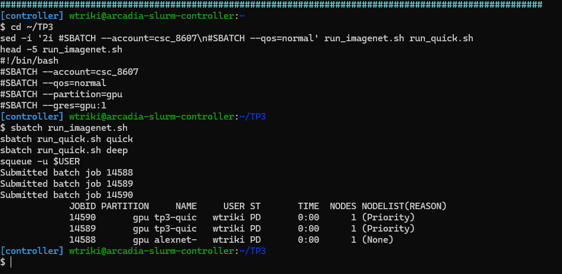

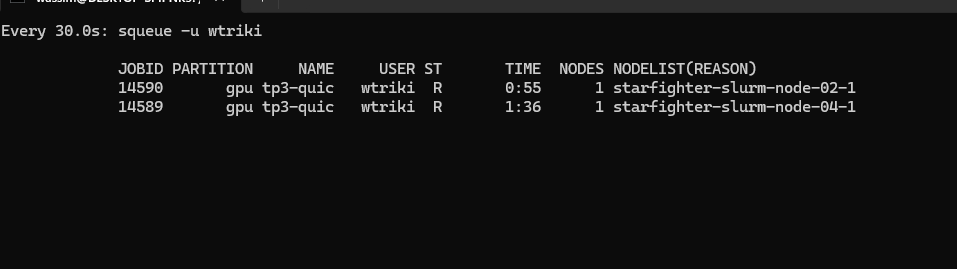

### 3.a.1 Rôle de `model.train()` / `model.eval()`

Ces méthodes changent le mode des couches dont le comportement diffère entre entraînement et inférence (ici `nn.Dropout`) :

- **`model.train()`** : chaque Dropout met à zéro aléatoirement 50 % des neurones à chaque passage et multiplie les neurones restants par 1/(1−p) = 2 (*inverted dropout*), pour garder la même espérance. Cela empêche la co-adaptation des neurones et régularise.
- **`model.eval()`** : le Dropout devient l'identité ; tout le réseau est utilisé de façon déterministe.

Si l'on **oubliait `model.eval()`** pendant l'évaluation, la moitié des neurones serait éteinte aléatoirement : les prédictions seraient **bruitées et non reproductibles** (deux évaluations donneraient des résultats différents), la val loss serait **artificiellement plus élevée** et l'accuracy plus basse. L'Early Stopping et la sauvegarde du meilleur modèle se baseraient sur une métrique faussée.

(À noter : `model.eval()` ne désactive pas le calcul des gradients ; c'est le rôle de `@torch.no_grad()`, qui économise mémoire et temps.)

### 3.a.2 Valeurs à l'initialisation

Avec 1000 classes équilibrées et un modèle qui prédit au hasard (sortie ≈ uniforme, p ≈ 1/1000 pour chaque classe) :

- **Accuracy** = 1/1000 = **0,1 %**
- **CrossEntropyLoss** = −ln(1/1000) = **ln(1000) ≈ 6,908**

Mes valeurs à la 1re époque :

| Modèle | Train Loss ép. 1 | Train Acc ép. 1 | Val Loss ép. 1 | Val Acc ép. 1 |
|---|---|---|---|---|
| MLP | 7,2147 | 0,10 % | 7,0304 | 0,06 % |
| AlexNet | 6,9065 | 0,06 % | 6,8985 | 0,08 % |
| AlexNet profond | 6,9081 | 0,10 % | 6,9079 | 0,12 % |

**C'est cohérent.** Les accuracies de la 1re époque sont toutes de l'ordre de 0,1 %, c'est-à-dire du hasard. Pour AlexNet et sa version profonde, la loss vaut presque exactement ln(1000) ≈ 6,91 : la sortie initiale est quasi uniforme, l'initialisation n'introduit pas de biais et le code d'évaluation est correct.

Le **MLP démarre au-dessus** (7,21 en train, 7,03 en validation). Sa première couche somme 154 587 entrées : avec l'initialisation par défaut, les logits initiaux ont une variance plus grande que pour AlexNet, la sortie n'est pas parfaitement uniforme et le modèle est « confiant à tort » sur des classes au hasard, ce qui coûte plus que ln(1000). Dès l'époque 2, sa loss revient vers 6,95.

### 3.a.3 Comparaison MLP vs AlexNet (20 000 images)

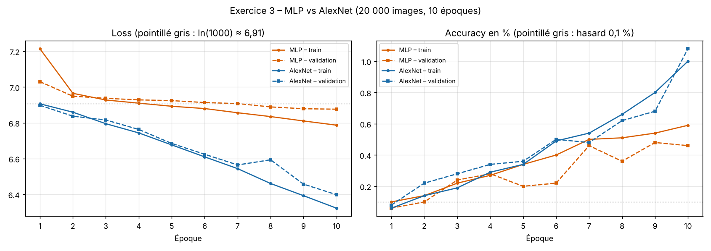

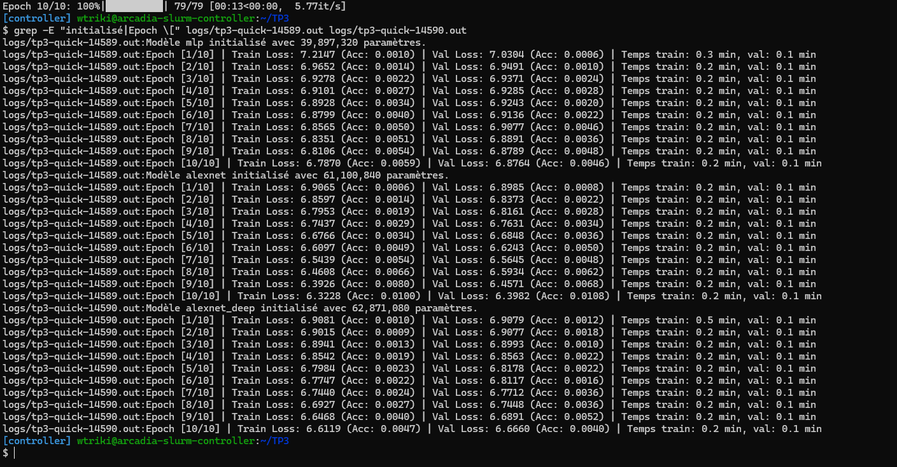

| Époque | MLP Train Loss | MLP Val Loss | MLP Train Acc | MLP Val Acc | AlexNet Train Loss | AlexNet Val Loss | AlexNet Train Acc | AlexNet Val Acc |
|---|---|---|---|---|---|---|---|---|
| 1 | 7,2147 | 7,0304 | 0,10 % | 0,06 % | 6,9065 | 6,8985 | 0,06 % | 0,08 % |
| 2 | 6,9652 | 6,9491 | 0,14 % | 0,10 % | 6,8597 | 6,8373 | 0,14 % | 0,22 % |
| 3 | 6,9278 | 6,9371 | 0,22 % | 0,24 % | 6,7953 | 6,8161 | 0,19 % | 0,28 % |
| 4 | 6,9101 | 6,9285 | 0,27 % | 0,28 % | 6,7437 | 6,7631 | 0,29 % | 0,34 % |
| 5 | 6,8928 | 6,9243 | 0,34 % | 0,20 % | 6,6766 | 6,6848 | 0,34 % | 0,36 % |
| 6 | 6,8799 | 6,9136 | 0,40 % | 0,22 % | 6,6097 | 6,6243 | 0,49 % | 0,50 % |
| 7 | 6,8565 | 6,9077 | 0,50 % | 0,46 % | 6,5439 | 6,5645 | 0,54 % | 0,48 % |
| 8 | 6,8351 | 6,8891 | 0,51 % | 0,36 % | 6,4608 | 6,5934 | 0,66 % | 0,62 % |
| 9 | 6,8106 | 6,8789 | 0,54 % | 0,48 % | 6,3926 | 6,4571 | 0,80 % | 0,68 % |
| 10 | 6,7870 | 6,8764 | 0,59 % | 0,46 % | 6,3228 | 6,3982 | 1,00 % | **1,08 %** |

Temps : environ 0,2 min d'entraînement et 0,1 min de validation par époque pour les deux modèles (GPU NVIDIA L4).

**Qui apprend le mieux ? AlexNet, nettement.** En 10 époques, sa val loss passe de 6,90 à 6,40 (−0,50) et sa val accuracy atteint **1,08 %**, soit 10 fois le hasard. Le MLP ne gagne que −0,07 en val loss depuis l'époque 2 (6,95 → 6,88) et plafonne à **0,46 %** de val accuracy, avec une courbe de validation très irrégulière (0,20 % à l'époque 5, 0,36 % à l'époque 8). Les convolutions exploitent la structure locale de l'image (bords, textures) et réutilisent les mêmes filtres partout, ce qui produit des caractéristiques qui **généralisent**. Le MLP, qui voit l'image aplatie, ne dispose d'aucun de ces a priori.

**Qui sur-apprend le plus vite ? Le MLP.** Sur seulement 10 époques, aucun des deux n'est encore en fort sur-apprentissage (les deux restent en sous-apprentissage global, avec une loss encore proche de 6,9). Mais le signe apparaît d'abord chez le MLP :
- son écart val − train sur la loss devient positif dès l'époque 3 et se creuse régulièrement (+0,03 à l'époque 5, +0,09 à l'époque 10) ;
- surtout, ce qu'il gagne en entraînement ne se transfère presque pas : de l'époque 2 à 10, sa train loss baisse de 0,18 mais sa val loss de seulement 0,07 (soit 40 % du gain). Pour AlexNet, la train loss baisse de 0,54 et la val loss de 0,44 (80 % du gain) ;
- à l'époque 10, sa train accuracy (0,59 %) dépasse sa val accuracy (0,46 %), alors que celle d'AlexNet est même un peu meilleure en validation (1,08 % contre 1,00 %).

Pourquoi : avec ≈ 20 images par classe et 39,6 millions de poids dans sa seule première couche, le MLP commence à **mémoriser les pixels** des images d'entraînement plutôt qu'à apprendre des motifs réutilisables. Il n'a ni Dropout, ni partage de poids. AlexNet sur-apprend plus lentement grâce au **Dropout** (p = 0,5 dans le classifieur) et au **biais inductif des convolutions** (connectivité locale, poids partagés). Sur 20 000 images, il finirait toutefois lui aussi par sur-apprendre si l'on prolongeait l'entraînement.

### 3.b Impact de la profondeur (AlexNet + 3 convolutions)

`AlexNetDeep` ajoute 3 couches `Conv2d(256, 256, 3, padding=1) + ReLU` après Conv5 (taille conservée 256 × 13 × 13, le classifieur est inchangé). Paramètres : 61 100 840 + 3 × 590 080 = **62 871 080**, ce que confirme le log (« Modèle alexnet_deep initialisé avec 62,871,080 paramètres »).

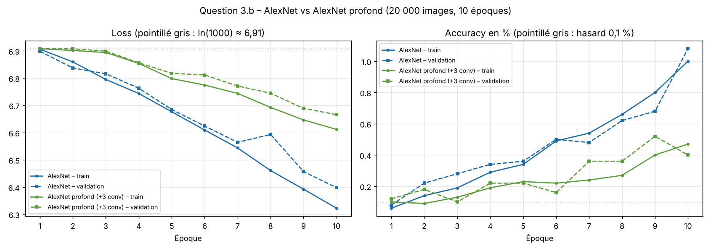

| Époque | AlexNet Train Loss | AlexNet Val Loss | Profond Train Loss | Profond Val Loss | Profond Train Acc | Profond Val Acc |
|---|---|---|---|---|---|---|
| 1 | 6,9065 | 6,8985 | 6,9081 | 6,9079 | 0,10 % | 0,12 % |
| 2 | 6,8597 | 6,8373 | 6,9015 | 6,9077 | 0,09 % | 0,18 % |
| 3 | 6,7953 | 6,8161 | 6,8941 | 6,8993 | 0,13 % | 0,10 % |
| 4 | 6,7437 | 6,7631 | 6,8542 | 6,8563 | 0,19 % | 0,22 % |
| 5 | 6,6766 | 6,6848 | 6,7984 | 6,8178 | 0,23 % | 0,22 % |
| 6 | 6,6097 | 6,6243 | 6,7747 | 6,8117 | 0,22 % | 0,16 % |
| 7 | 6,5439 | 6,5645 | 6,7440 | 6,7712 | 0,24 % | 0,36 % |
| 8 | 6,4608 | 6,5934 | 6,6927 | 6,7448 | 0,27 % | 0,36 % |
| 9 | 6,3926 | 6,4571 | 6,6468 | 6,6891 | 0,40 % | 0,52 % |
| 10 | 6,3228 | 6,3982 | 6,6119 | 6,6660 | 0,47 % | 0,40 % |

**Observation.** Le réseau profond reste **bloqué sur un plateau pendant les 3 premières époques** : sa train loss ne passe que de 6,908 à 6,894, toujours collée à ln(1000), et son accuracy reste au niveau du hasard (0,09–0,13 %). Au même moment, AlexNet standard est déjà descendu à 6,795. Le réseau profond ne « décolle » qu'à partir de l'époque 4, et finit à 6,61 contre 6,32 pour AlexNet (val accuracy 0,40 % contre 1,08 %).

**C'est du sous-apprentissage (underfitting), pas du sur-apprentissage.** C'est **la loss d'entraînement elle-même** qui reste haute : le réseau n'arrive même pas à bien s'ajuster aux données qu'il voit, alors qu'il a plus de capacité qu'AlexNet. L'écart entre train et validation reste d'ailleurs du même ordre que celui d'AlexNet (+0,05 contre +0,08 à l'époque 10). En sur-apprentissage, on verrait l'inverse : une train loss qui descend bien et une val loss qui décroche.

**Explication par la propagation du gradient.** Pendant la backpropagation, le gradient qui atteint les premières couches est un **produit** des dérivées de toutes les couches traversées (règle de la chaîne). Le réseau compte maintenant 8 convolutions + 3 couches denses, **sans BatchNorm ni connexions résiduelles**, avec l'initialisation par défaut de PyTorch, qui ne conserve pas exactement la variance à travers des couches ReLU. Chaque couche supplémentaire multiplie le signal par un facteur souvent inférieur à 1 : le gradient **s'atténue avec la profondeur** (*vanishing gradient*), et les ReLU annulent en plus le gradient de toutes les activations négatives. Les premières couches reçoivent donc des mises à jour minuscules, le réseau reste longtemps près de son initialisation (le plateau à 6,91), puis apprend plus lentement. C'est précisément le problème que résolvent la BatchNorm, l'initialisation de He (Kaiming) et les connexions résiduelles de ResNet.

---

## Exercice 4 – Entraînement long sur ImageNet complet

Dans `train_imagenet.py`, le mode `full` (par défaut) appelle :

```python
train_model(model_name="alexnet", subset_size=None, num_epochs=50)
```

Script `run_imagenet.sh` : partition `gpu`, 1 GPU, 8 CPU (pour `num_workers=8`), 24 Go de RAM, 4 h, puis `python -u train_imagenet.py --mode full` (`-u` désactive le tampon de sortie pour voir les logs en direct).

Soumission : `sbatch run_imagenet.sh`, puis `squeue -u $USER` → état **R** ✅ (job n° **14591**, nœud `starfighter-slurm-node-02-1`, GPU **NVIDIA L4, 23 Go**).

Un premier essai (job 14588) a échoué au bout de 40 s : les trois jobs ont démarré en même temps sur des nœuds différents et ont tenté de créer le dossier `runs/` au même moment sur le disque partagé (`FileNotFoundError`). Correction : création préalable de `runs/` et ajout de `os.makedirs(f"runs/{run_tag}", exist_ok=True)` avant le `SummaryWriter`.

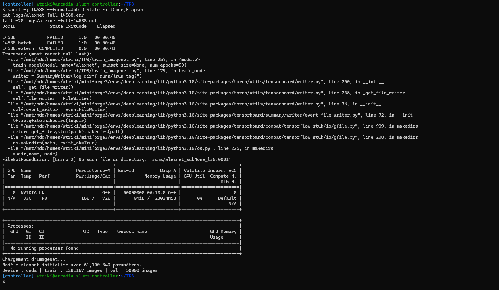

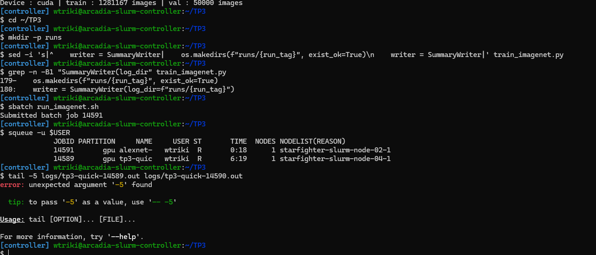

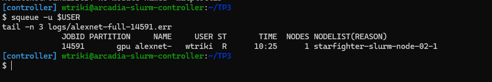

### 4.1 Profilage temporel et matériel

Mesures tirées de `logs/alexnet-full-14591.out` (ligne de l'époque 1) :

```
Epoch [1/50] | Train Loss: 5.6906 (Acc: 0.0451) | Val Loss: 4.7171 (Acc: 0.1145) | Temps train: 22.6 min, val: 1.1 min
```

- Durée d'une époque d'entraînement complète (1 281 167 images, 5 005 batches de 256) : **22,6 min, soit environ 22 min 36 s**, plus **1,1 min (≈ 1 min 06 s)** de validation sur 50 000 images. Une époque complète prend donc **≈ 23,7 min**.
- Débit : 1 281 167 / (22,6 × 60) ≈ **945 images/s**, soit 6 à 7 batches/s d'après la barre de progression.
- Pour **100 époques sans Early Stopping** : 100 × 23,7 min = 2 370 min ≈ **39,5 heures**, soit plus d'une journée et demie de GPU (37,7 h rien que pour l'entraînement).

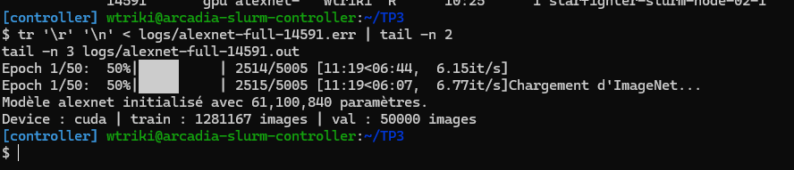

Remarques :
- Avec `--time=04:00:00`, Slurm arrêtera le job après 4 h, soit **≈ 10 époques** (240 / 23,7). Pour aller au bout des 50 ou 100 époques, il faudrait sauvegarder un checkpoint complet (modèle + optimiseur + numéro d'époque) et reprendre l'entraînement dans plusieurs jobs successifs.
- Le facteur limitant est très probablement le **chargement des données** (lecture et décodage de ~945 JPEG par seconde, plus les transformations aléatoires, sur 8 CPU) plutôt que le GPU : AlexNet est un petit réseau pour un L4. On pourrait accélérer en augmentant `num_workers` (et `--cpus-per-task`), ou en décodant les images sur GPU (NVIDIA DALI).

### 4.2 Analyse de l'entraînement sur le dataset complet

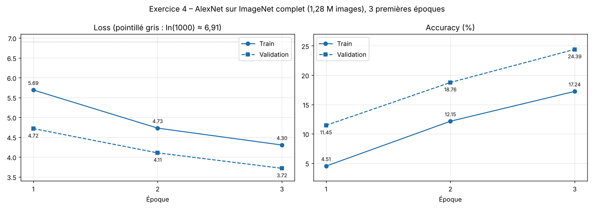

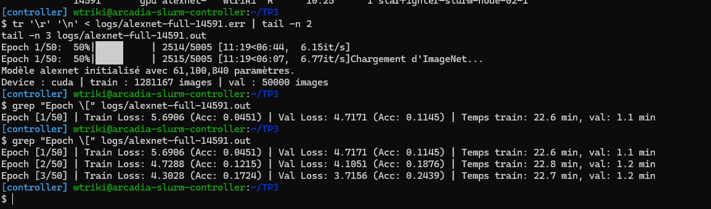

| Époque | Train Loss | Val Loss | Écart (val − train) | Train Acc | Val Acc | Temps train | Temps val |
|---|---|---|---|---|---|---|---|
| 1 | 5,6906 | 4,7171 | −0,97 | 4,51 % | 11,45 % | 22,6 min | 1,1 min |
| 2 | 4,7288 | 4,1051 | −0,62 | 12,15 % | 18,76 % | 22,8 min | 1,2 min |
| 3 | 4,3028 | 3,7156 | −0,59 | 17,24 % | **24,39 %** | 22,7 min | 1,2 min |

Le temps par époque est très stable (22,6 à 22,8 min), ce qui confirme l'estimation de la question 4.1.

En 3 époques, AlexNet passe de 6,91 (hasard) à **3,72** de val loss et atteint **24,4 % de val accuracy**, soit 244 fois le hasard. Sur le sous-ensemble de 20 000 images, il n'atteignait que 1,08 % après 10 époques. Les trois courbes de validation progressent à chaque époque : aucun signe de stagnation.

**Comparaison de l'écart train/val.**
- Sur **20 000 images** (exercice 3), la val loss passait au-dessus de la train loss au fil des époques : à l'époque 10, l'écart val − train était de **+0,075** pour AlexNet et **+0,089** pour le MLP, et il se creusait. Le modèle commençait à mieux réussir sur les images vues que sur les nouvelles.
- Sur **ImageNet complet**, c'est l'inverse : la val loss reste **nettement en dessous** de la train loss (écart de **−0,97, −0,62 puis −0,59**), et la val accuracy dépasse la train accuracy de 7 points. Il n'y a **aucun sur-apprentissage** visible : l'écart se resserre seulement, parce que l'effet des biais de mesure décrits en 4.3 diminue quand le modèle progresse moins vite.

Pourquoi le sur-apprentissage est beaucoup plus faible :

1. **64 fois plus de données** : ≈ 1 280 images par classe au lieu de ≈ 20. Avec 61 M paramètres, le réseau ne peut plus mémoriser chaque exemple ; la seule façon de faire baisser la loss est d'apprendre des caractéristiques générales.
2. **Chaque image n'est vue que quelques fois** en quelques époques, et à chaque passage sous une forme différente grâce à l'**augmentation de données** (`RandomResizedCrop` + flip) : le nombre effectif d'exemples distincts est encore bien plus grand.
3. Le **Dropout** et le `weight_decay` continuent de régulariser.

On est encore au tout début de l'apprentissage, en régime de sous-apprentissage : 24 % de val accuracy, alors que le modèle AlexNet de référence de torchvision atteint environ 56,5 % en top-1 après un entraînement complet (90 époques). Le modèle est loin d'avoir épuisé sa capacité, et la question du sur-apprentissage ne se posera qu'après de nombreuses époques.

### 4.3 Observation surprenante : val loss < train loss

**Je l'observe dès la 1re époque et sur les trois** : val loss 4,72 contre 5,69 en train à l'époque 1 (écart de −0,97), puis −0,62 et −0,59. De même, la val accuracy (11,5 %, 18,8 %, 24,4 %) dépasse toujours la train accuracy (4,5 %, 12,2 %, 17,2 %).

Deux raisons techniques liées au code, c'est-à-dire à ce qui est actif pendant l'entraînement mais pas pendant la validation :

1. **Le Dropout** : en `model.train()`, la moitié des neurones du classifieur est éteinte aléatoirement ; le réseau travaille « handicapé » et ses prédictions sont moins bonnes. En `model.eval()`, le Dropout est désactivé et le réseau complet est utilisé : il prédit mieux, donc la val loss est plus faible.
2. **L'augmentation de données** : les images d'entraînement passent par `RandomResizedCrop`, qui peut ne garder qu'une petite zone de l'image (8 % de la surface au minimum), avec un ratio déformé, parfois sans l'objet entier : ce sont des exemples **plus difficiles**. Les images de validation sont seulement redimensionnées et recadrées au centre, où se trouve généralement l'objet : elles sont **plus faciles**.

Raison supplémentaire (liée à la mesure) : la **train loss est une moyenne sur toute l'époque**, calculée pendant que les poids évoluent ; elle inclut les mauvais batches du début de l'époque. La val loss est calculée **à la fin de l'époque** avec les poids déjà améliorés. Quand le modèle progresse vite (premières époques), ce décalage d'environ une demi-époque suffit à placer la val loss sous la train loss.

---

## Conclusion

- À nombre de paramètres comparable, le MLP met presque tout son budget dans une première couche dense qui ignore la structure de l'image ; il sur-apprend vite et généralise mal.
- AlexNet place ses paramètres dans le classifieur dense mais sa mémoire dans les premières convolutions ; le partage des poids lui donne un biais inductif adapté aux images.
- Empiler des couches sans BatchNorm ni connexions résiduelles gêne la propagation du gradient (sous-apprentissage initial).
- Sur ImageNet complet avec augmentation de données, le sur-apprentissage disparaît des premières époques ; le facteur limitant devient le temps de calcul (≈ 23,7 min par époque, soit ≈ 39,5 h pour 100 époques sur un GPU L4).
