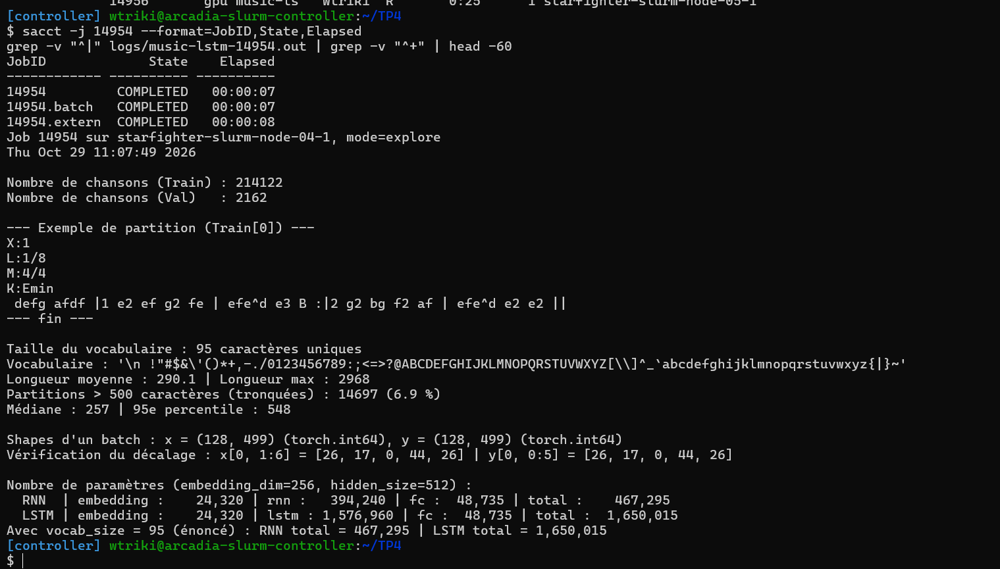
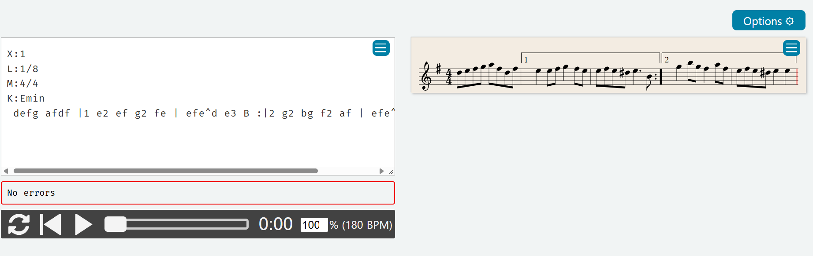
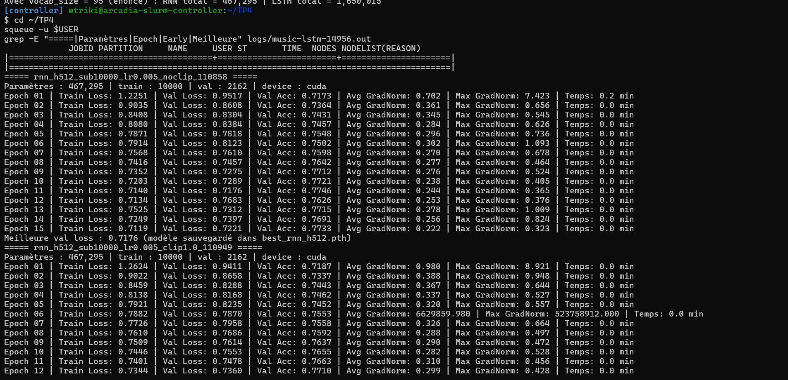
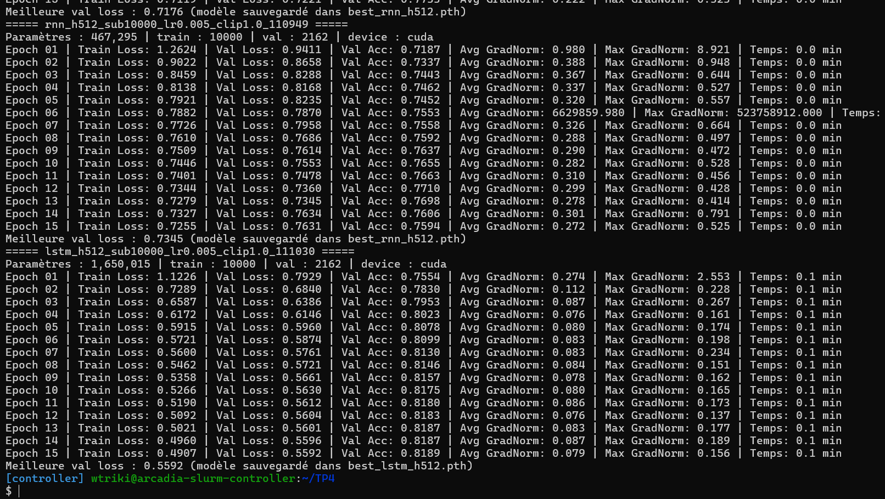
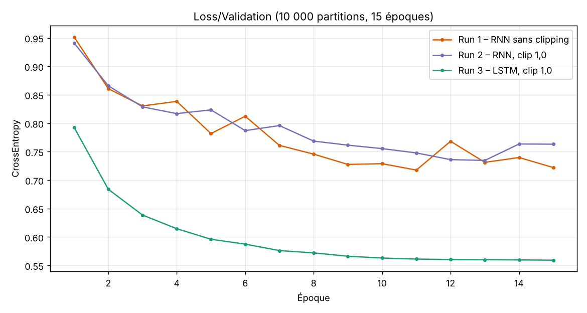
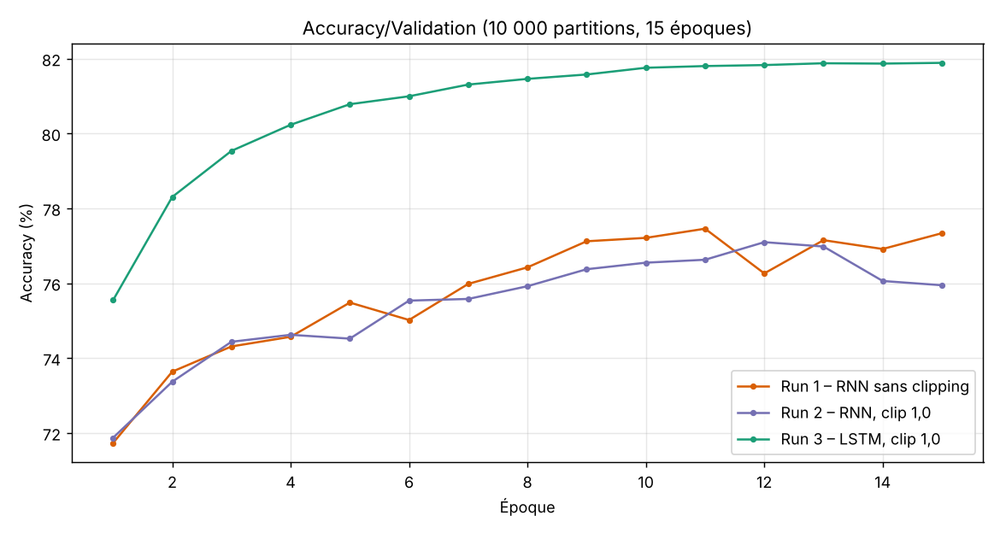
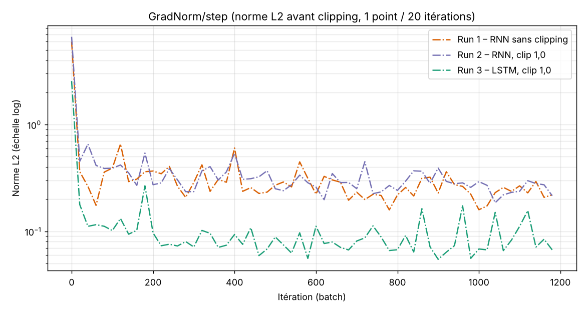
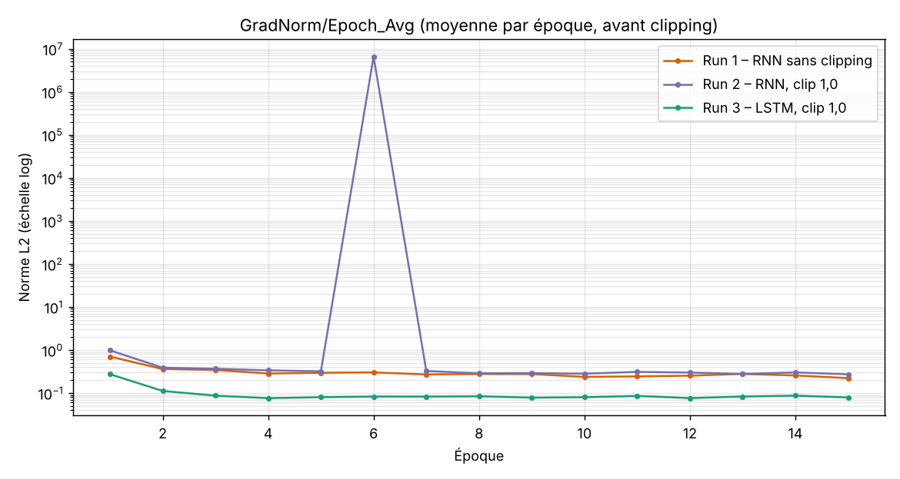
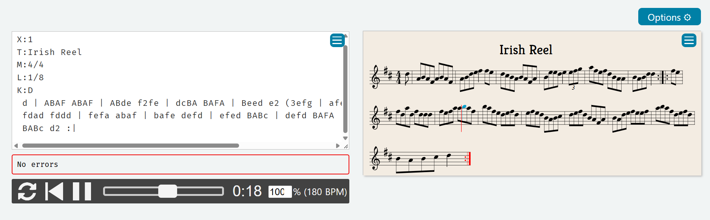
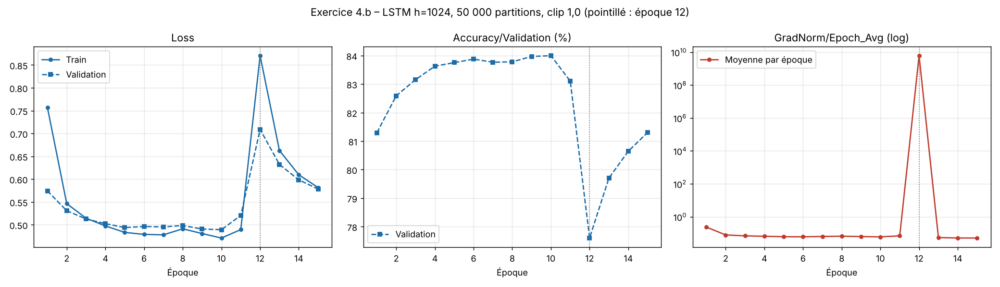

# CSC 8607 – TP4 : Réseaux récurrents et génération de partitions ABC

**Fichiers du dossier TP4/**

| Fichier | Rôle |
|---|---|
| train\_music.py | Chargement, vocabulaire, MusicDataset, MusicModel (RNN/LSTM), evaluate\_model, train\_model (norme des gradients, clipping, Early Stopping), generate\_music. Modes : --mode explore, quick, generate, full |
| run\_music.sh | Job Slurm (sbatch run\_music.sh \[mode\]) |
| figures/ | Courbes TensorBoard insérées dans ce rapport |
| captures/ | Captures d'écran (terminal, ABC Player) |
| generations/ | Partitions ABC générées |
| logs/ | Sorties Slurm des jobs |

---

## Exercice 1 – Exploration et prétraitement des partitions ABC

### Étape 1 – Chargement

```python
def load_data(file_path):
    with open(file_path, "r", encoding="utf-8") as f:
        return json.load(f)
```

#### 1.a.1 Nombre de partitions

Résultat de sbatch run\_music.sh explore (job 14954) :

- train.json : **214 122** partitions
- validation.json : **2 162** partitions



#### 1.a.2 Première partition et rôle de l'en-tête

```
X:1
L:1/8
M:4/4
K:Emin
 defg afdf |1 e2 ef g2 fe | efe^d e3 B :|2 g2 bg f2 af | efe^d e2 e2 ||
```

Lecture de cette partition (collée dans ABC Player) : un air en **mi mineur**, à **4 temps**, écrit en **croches** par défaut. Les quatre premières lignes sont l'en-tête : X:1, L:1/8, M:4/4 et K:Emin. Il n'y a pas de titre T: : dans ce jeu de données, les en-têtes se limitent souvent à l'essentiel. La ligne de notes contient :
- des **notes** (d e f g a, minuscules = octave aiguë ; B majuscule = octave médium) et des **durées** relatives à L:1/8 (e2 = noire, e3 = noire pointée) ;
- des **barres de mesure** \|, une **barre finale** \|\| et une **reprise** :\| ;
- des **fins alternatives** \|1 et :\|2 (1re et 2de fois) ;
- une **altération** ^d (ré dièse), la sensible de mi mineur, qui n'est pas dans l'armure.



ABC Player affiche « No errors » : on voit l'armure à un dièse (mi mineur), la mesure 4/4 et les crochets « 1 » et « 2 » des deux fins alternatives.

Vérification du rythme avec L:1/8 et M:4/4 : chaque mesure doit faire 8 croches. Par exemple e2 ef g2 fe = 2 + 1 + 1 + 2 + 1 + 1 = 8 ✓ et efe^d e3 B = 1 + 1 + 1 + 1 + 3 + 1 = 8 ✓.

En-tête ABC (lignes Lettre:valeur avant les notes) :

| Champ | Rôle |
|---|---|
| X: | Numéro de référence de la partition dans le recueil. C'est obligatoirement le premier champ : il marque le début d'un nouvel air. |
| T: | Titre du morceau (s'il est présent). |
| M: | Métrique (mesure) : nombre et valeur des temps par mesure, par exemple 6/8 (2 temps de 3 croches, typique d'une *jig*) ou 4/4 (*reel*). Le lecteur s'en sert pour placer les barres et l'accentuation. |
| L: | Durée de note par défaut : L:1/8 veut dire qu'une lettre seule (A) dure une croche ; A2 dure deux fois plus, A/2 deux fois moins. |
| K: | Tonalité (armure), par exemple G (sol majeur, un fa ♯) ou Dmaj. C'est le dernier champ de l'en-tête : tout ce qui suit est la mélodie. Elle fixe les altérations implicites des notes. |
| R: | (si présent) Type de danse : *reel*, *jig*, *hornpipe*… |

Pour le modèle, l'en-tête est un **contexte global** : la métrique et la tonalité conditionnent toute la suite (nombre de notes par mesure, notes « autorisées »). Un modèle auto-régressif qui a lu M:6/8 et K:G en début de séquence doit en garder la trace sur des centaines de caractères, ce qui exige une mémoire à long terme.

### Étape 2 – Vocabulaire et padding

```python
unique_chars = sorted(list(set(all_text)))
char_to_index = {char: idx for idx, char in enumerate(unique_chars)}
index_to_char = {idx: char for idx, char in enumerate(unique_chars)}

def vectorize_string(s):
    return [char_to_index[char] for char in s]

def pad_or_truncate(sequence, max_length=SEQ_LENGTH):
    if len(sequence) < max_length:
        return sequence + " " * (max_length - len(sequence))
    else:
        return sequence[:max_length]
```

#### 1.b.1 Statistiques

- Taille du vocabulaire : **95 caractères uniques**, soit le retour à la ligne plus 94 des 95 caractères ASCII imprimables (de l'espace au tilde). Seul le caractère % est absent : en ABC, il sert à écrire des commentaires, qui ont été retirés du jeu de données. Vocabulaire complet :

  ```
  '\n !"#$&\'()*+,-./0123456789:;<=>?@ABCDEFGHIJKLMNOPQRSTUVWXYZ[\\]^_`abcdefghijklmnopqrstuvwxyz{|}~'
  ```

- Longueur moyenne : **290,1 caractères** ; longueur maximale : **2 968 caractères** (médiane 257, 95e percentile 548)
- Partitions plus longues que 500 caractères (donc tronquées) : **14 697, soit 6,9 %** du jeu d'entraînement

#### 1.b.2 Pourquoi sorted(...) ?

Un set Python n'a **pas d'ordre garanti**. Pour les chaînes de caractères, l'ordre d'itération dépend de leur valeur de hachage, et Python **randomise le hachage des chaînes à chaque lancement de l'interpréteur** (PYTHONHASHSEED, activé par défaut pour des raisons de sécurité). Sans sorted(), deux exécutions du même script peuvent donc construire des char\_to\_index différents : 'A' peut valoir 12 aujourd'hui et 47 demain.

Si l'on sauvegardait les poids aujourd'hui et qu'on relançait le script demain pour générer :
- la ligne 12 de la matrice d'Embedding (apprise pour 'A') serait utilisée pour un autre caractère ;
- la sortie n° 47 de la couche fc (apprise pour prédire 'A') serait décodée en un autre caractère par index\_to\_char.

Le modèle se chargerait **sans aucune erreur** (les dimensions sont identiques), mais il recevrait et produirait des caractères mélangés : la musique générée serait du charabia. sorted() rend le vocabulaire **déterministe** : il ne dépend que de l'ensemble des caractères, pas de l'exécution. (Une alternative robuste consiste à sauvegarder char\_to\_index avec les poids.)

#### 1.b.3 Pourquoi tronquer à 500 plutôt que padder jusqu'à max\_len ?

max\_len (**2 968** caractères) est plus de **10 fois** plus grand que la longueur typique (**290** en moyenne, **257** en médiane). Padder tout le monde jusqu'à max\_len aurait trois coûts :

- **Temps de calcul** : un RNN traite les pas de temps **séquentiellement** (h_t dépend de h_{t-1}), on ne peut pas paralléliser sur la longueur. Le coût d'un batch est proportionnel à seq\_len : passer de 500 à max\_len multiplierait le temps d'une époque par environ max\_len / 500 (**≈ 5,9**), alors que l'immense majorité des pas de temps ajoutés ne contiendrait que des espaces.
- **Mémoire GPU** : la BPTT garde en mémoire les activations de **tous** les pas de temps pour le backward. La mémoire des activations est proportionnelle à batch\_size × seq\_len × hidden\_size ; elle exploserait d'autant, au point de forcer à réduire le batch.
- **Apprentissage** : la plupart des cibles deviendraient du padding. La loss serait dominée par la tâche triviale « après un espace de padding vient un espace », ce qui dilue le signal utile et biaise le modèle vers la prédiction d'espaces. Les séquences très longues aggravent aussi le *vanishing/exploding gradient* (le gradient traverse plus de pas).

Tronquer à 500 (≈ 2 × la moyenne) garde **la quasi-totalité** des partitions entières (**6,9 %** seulement sont coupées) et ne perd que la fin des morceaux les plus longs. Le padding reste modéré, et le coût d'un batch est maîtrisé.

---

## Exercice 2 – Dataset auto-régressif et modélisation

### Étape 1 – MusicDataset

```python
def __getitem__(self, idx):
    seq = self.data[idx]
    x = torch.tensor(seq[:-1], dtype=torch.long)  # tous les caractères sauf le dernier
    y = torch.tensor(seq[1:], dtype=torch.long)   # tous sauf le premier (décalage de +1)
    return x, y
```

#### 2.a Shapes et type

Avec SEQ\_LENGTH = 500 et BATCH\_SIZE = 128, chaque séquence de 500 indices donne 499 entrées et 499 cibles :

- x : **(128, 499)**, torch.int64
- y : **(128, 499)**, torch.int64

(sauf le dernier batch de l'époque, qui contient le reste, par exemple (16, 499) pour 10 000 partitions : 10 000 = 78 × 128 + 16.)

Vérifié par --mode explore : Shapes d'un batch : x = (128, 499) (torch.int64), y = (128, 499) (torch.int64), et x\[0, 1:6\] = \[26, 17, 0, 44, 26\] = y\[0, 0:5\] = \[26, 17, 0, 44, 26\]. Le contrôle x\[0, 1:6\] == y\[0, 0:5\] confirme le décalage d'un pas de temps : la cible au temps t est l'entrée au temps t + 1.

**Pourquoi torch.long ?** Ces tenseurs contiennent des **indices de catégories**, pas des grandeurs continues :
- nn.Embedding attend des indices entiers (LongTensor ou IntTensor) pour aller chercher une ligne de sa table ; un float n'a pas de sens comme numéro de ligne.
- nn.CrossEntropyLoss attend des cibles de classe entières de type long (int64) pour sélectionner le logit de la bonne classe.
- Un float32 introduirait de plus des approximations (un index n'est pas une valeur qu'on additionne ou qu'on dérive) et laisserait croire à une relation d'ordre entre caractères.

### Étape 2 – MusicModel

```python
self.embedding = nn.Embedding(vocab_size, embedding_dim)
self.rnn = nn.LSTM(embedding_dim, hidden_size, batch_first=True)   # ou nn.RNN(...)
self.fc = nn.Linear(hidden_size, vocab_size)
```

#### 2.b.1 Calcul théorique des paramètres (V = 95, E = 256, H = 512)

**Embedding** : une table de V vecteurs de dimension E : 95 × 256 = **24 320**.

**RNN (Elman)** : h_t = tanh(W_ih x_t + b_ih + W_hh h_{t−1} + b_hh)

| Terme | Dimension | Paramètres |
|---|---|---|
| W_ih | H × E = 512 × 256 | 131 072 |
| W_hh | H × H = 512 × 512 | 262 144 |
| b_ih | H | 512 |
| b_hh | H | 512 |
| **Total RNN** | | **394 240** |

**LSTM** : 4 portes (entrée i, oubli f, candidat g, sortie o), chacune avec ses propres W_ih, W_hh, b_ih, b_hh de mêmes dimensions que le RNN. PyTorch les empile en matrices de 4H lignes :

| Terme | Dimension | Paramètres |
|---|---|---|
| W_ih | 4H × E = 2048 × 256 | 524 288 |
| W_hh | 4H × H = 2048 × 512 | 1 048 576 |
| b_ih | 4H | 2 048 |
| b_hh | 4H | 2 048 |
| **Total LSTM** | | **1 576 960** |

**Couche fc** : H × V + V = 512 × 95 + 95 = **48 735**.

| Modèle | Embedding | Bloc récurrent | fc | **Total** |
|---|---|---|---|---|
| RNN | 24 320 | 394 240 | 48 735 | **467 295** |
| LSTM | 24 320 | 1 576 960 | 48 735 | **1 650 015** |

Vérification par count\_parameters : avec V = 95, j'obtiens bien **467 295** (RNN) et **1 650 015** (LSTM). Le vrai vocabulaire faisant justement **V = 95**, --mode explore donne exactement les mêmes valeurs, couche par couche :

```
RNN  | embedding :     24,320 | rnn  :   394,240 | fc :  48,735 | total :    467,295
LSTM | embedding :     24,320 | lstm : 1,576,960 | fc :  48,735 | total :  1,650,015
```

**Le bloc LSTM a-t-il exactement 4 fois plus de paramètres que le bloc RNN ?** **Oui** : 4 × 394 240 = 1 576 960. Un RNN calcule une seule transformation affine de (x_t, h_{t−1}) ; un LSTM en calcule quatre, de mêmes dimensions (une par porte i, f, g, o). En revanche, le **modèle complet** n'a pas 4 fois plus de paramètres (1 650 015 / 467 295 ≈ 3,53), car l'Embedding et la couche fc sont identiques dans les deux cas.

#### 2.b.2 Pourquoi nn.Embedding plutôt qu'une couche linéaire 1 → E sur l'indice ?

Passer l'indice scalaire i dans nn.Linear(1, E) donnerait le vecteur i·w + b :
- **Ordre et distances artificiels** : l'indice est arbitraire (il vient de l'ordre alphabétique de sorted). Le caractère n° 10 serait traité comme « presque » le n° 11 et « très loin » du n° 80, sans aucune raison musicale.
- **Expressivité quasi nulle** : tous les caractères seraient sur **une même droite** de l'espace R^E (des multiples d'un seul vecteur w, décalés de b). Le réseau ne pourrait pas donner à chaque caractère une représentation propre.

nn.Embedding est une **table de correspondance** : chaque caractère a son propre vecteur de dimension E, appris librement. C'est mathématiquement équivalent à multiplier un vecteur *one-hot* de taille V par une matrice V × E, sans hypothèse d'ordre entre catégories, mais en bien plus efficace (on lit une ligne au lieu de faire un produit matriciel avec un vecteur presque vide). Le réseau peut ainsi rapprocher les caractères qui jouent des rôles voisins (les notes A–G entre elles, les chiffres de durée entre eux, les barres \| et :…).

#### 2.b.3 Différence entre les hidden\_state du RNN et du LSTM

- **nn.RNN** renvoie **un seul tenseur** h_n, de forme (num\_layers, batch, hidden\_size) = (1, B, 512) : le dernier état caché.
- **nn.LSTM** renvoie **un tuple (h\_n, c\_n)**, deux tenseurs de même forme (1, B, 512) :
  - **h_t (hidden state)** : la « mémoire de travail » ou sortie du LSTM au temps t, h_t = o_t ⊙ tanh(c_t). C'est elle qui est passée à la couche fc pour prédire le caractère suivant, et qui est réinjectée dans les portes au pas suivant.
  - **c_t (cell state)** : la **mémoire à long terme**, mise à jour de façon additive (c_t = f_t ⊙ c_{t−1} + i_t ⊙ g_t). Elle transporte l'information sur de longues distances (la métrique, la tonalité, le motif de la mélodie) sans être écrasée à chaque pas ; la porte de sortie o_t décide ce qu'on en expose dans h_t.

Il faut donc conserver **les deux** pour la génération : c'est ce que fait generate\_music en repassant le tuple hidden\_state à chaque pas.

---

## Exercice 3 – Entraînement, dynamique des gradients, RNN vs LSTM

Trous complétés (train\_music.py) :

```python
loss = loss_fn(logits.reshape(-1, vocab_size), y.reshape(-1))
...
grad_norm = torch.nn.utils.clip_grad_norm_(model.parameters(), max_norm=max_grad_norm)
...
optimizer.step()
```

Ajouts par rapport à l'énoncé : le nom du run contient hidden\_size et le fichier de sauvegarde s'appelle best\_{rnn\_type}\_h{hidden\_size}.pth, pour que l'entraînement long (h = 1024) n'écrase pas le meilleur LSTM du Run 3 (h = 512). J'affiche aussi la norme **maximale** des gradients de chaque époque et la durée d'une époque, et un paramètre max\_minutes arrête proprement l'entraînement long avant la limite de 2 h de Slurm, pour que la génération finale ait le temps de s'exécuter.

Lancement : sbatch run\_music.sh quick (les 3 runs à la suite, 15 époques, subset\_size = 10000, lr = 5e-3).

#### 3.1 Pourquoi logits.reshape(-1, vocab\_size) et y.reshape(-1) ?

nn.CrossEntropyLoss attend des logits de forme **(N, C)** (N exemples, C classes) et des cibles de forme **(N,)**. Or le modèle sort des logits de forme (batch, seq\_len, vocab\_size) et les cibles sont (batch, seq\_len). En modélisation caractère par caractère, **chaque pas de temps de chaque séquence est un problème de classification indépendant** à vocab\_size classes. On aplatit donc les deux premières dimensions :

- logits.reshape(-1, vocab\_size) → (batch × seq\_len, vocab\_size)
- y.reshape(-1) → (batch × seq\_len,)

Le -1 laisse PyTorch calculer la dimension : c'est le **nombre total de caractères à prédire dans le batch**, soit 128 × 499 = **63 872** pour un batch complet. La loss obtenue est la moyenne de l'entropie croisée sur ces 63 872 prédictions.

(Sans le reshape, PyTorch interpréterait (B, T, V) comme (N, C, d), c'est-à-dire avec les classes en 2e dimension : il prendrait les 499 pas de temps pour des classes, et lèverait une erreur ou calculerait une loss fausse.)

#### 3.2 Pourquoi clip\_grad\_norm\_ après loss.backward() et avant optimizer.step() ?

- **Après backward()** : ce sont les gradients p.grad que l'on mesure et que l'on réduit. Ils n'existent (pour ce batch) qu'une fois la rétropropagation terminée ; avant, ils valent None (on vient de faire zero\_grad).
- **Avant step()** : optimizer.step() utilise p.grad pour mettre à jour les poids. Il faut donc avoir rescalé les gradients **avant** la mise à jour. Le clipping appelé après step() ne servirait à rien : le pas trop grand aurait déjà été appliqué aux poids, et les gradients seraient remis à zéro au batch suivant.

clip\_grad\_norm\_ calcule la norme L2 globale ‖g‖ de tous les gradients concaténés ; si ‖g‖ > max\_norm, il les multiplie tous par max\_norm / ‖g‖ (même direction, longueur limitée). Il renvoie la norme **avant** clipping, ce qui permet de la tracer dans TensorBoard dans les deux cas (max\_norm = inf ne modifie rien).

#### 3.3 Analyse expérimentale

Job **14956** (sbatch run\_music.sh quick), les 3 runs à la suite sur un GPU :











GradNorm/step n'enregistre qu'une itération sur 20 : le pic du Run 2 (une seule itération à 5,2 × 10⁸) tombe entre deux points enregistrés et n'apparaît donc pas sur cette courbe. On le voit en revanche nettement sur la moyenne par époque GradNorm/Epoch\_Avg, calculée sur **toutes** les itérations :



Sur GradNorm/step, on voit aussi que les normes du LSTM (vert) sont **3 à 4 fois plus faibles** et plus régulières que celles des deux RNN, dès la 200e itération.

| Run | Modèle | Clipping | Meilleure Val Loss | Val Acc finale | Norme moyenne des gradients | Norme max | Temps / époque |
|---|---|---|---|---|---|---|---|
| 1 | RNN | aucun | 0,7176 (ép. 11) | 77,33 % | 0,22 – 0,36 (0,70 à l'ép. 1) | 7,42 (ép. 1), puis ≈ 1,1 (ép. 6 et 13) | < 3 s |
| 2 | RNN | 1,0 | 0,7345 (ép. 13) | 75,94 % | 0,27 – 0,39 (**6,6 × 10⁶ à l'ép. 6**) | **5,24 × 10⁸ (ép. 6)** | < 3 s |
| 3 | LSTM | 1,0 | **0,5592 (ép. 15)** | **81,89 %** | **0,076 – 0,11** (0,27 à l'ép. 1) | 2,55 (ép. 1), puis ≤ 0,27 | ≈ 6 s |

Les 15 époques ont été faites dans les trois cas (pas d'Early Stopping déclenché). Les durées sont très courtes : environ 79 batches par époque sur 10 000 partitions.

**Run 1 vs Run 2 (effet du clipping).**

- **Run 2 : une vraie explosion du gradient, neutralisée.** À l'époque 6, un batch a produit une norme de gradient de **523 758 912** (5,2 × 10⁸), alors que la norme typique est de 0,3. C'est cette seule valeur qui fait monter la moyenne de l'époque à 6,6 × 10⁶ (5,2 × 10⁸ / 79 batches). Grâce au clipping, la mise à jour correspondante a été ramenée à une norme de 1 : la loss n'en a pas souffert (val loss 0,8235 → **0,7870** à cette époque, elle a même baissé), et l'entraînement a continué normalement. Sans clipping, Adam aurait reçu un gradient 10⁹ fois trop grand ; même s'il normalise les pas, un tel gradient contamine ses moyennes de moments pendant des centaines d'itérations et peut faire diverger les poids, voire produire des NaN.
- **Run 1 : pas d'explosion aussi forte cette fois, mais des instabilités.** La norme reste en général entre 0,2 et 0,7, avec des pics à 1,09 (ép. 6) et 1,01 (ép. 13). Ces pics coïncident avec des **remontées de la loss** : à l'époque 6, la train loss remonte (0,7871 → 0,7914) et la val loss aussi (0,7818 → 0,8123) ; aux époques 12–13, la val loss saute de 0,7176 à 0,7683 puis la train loss de 0,7134 à 0,7525. Le RNN sans clipping progresse donc en dents de scie.
- **En loss finale, les deux runs sont proches** (meilleure val loss 0,7176 sans clipping, 0,7345 avec) : sur un seul tirage, l'écart est du même ordre que les fluctuations d'une époque à l'autre. L'intérêt du clipping n'est pas d'améliorer la loss d'un run qui se passe bien : c'est une **assurance contre les explosions**, qui surviennent de façon imprévisible (ici dans le Run 2 et pas dans le Run 1). Il rend l'entraînement **robuste** sans rien coûter quand les gradients sont normaux (une norme ≤ 1 n'est pas modifiée).

Les deux runs commencent aussi par une norme élevée à la 1re époque (max 7,4 et 8,9), quand les poids aléatoires sont loin d'un bon minimum, puis elle redescend.

Le problème corrigé est l'**explosion du gradient** (*exploding gradient*). En BPTT, le gradient de la loss au temps t par rapport à l'état h_k (k < t) est un produit de t − k jacobiennes :

∂h_t / ∂h_k = ∏_{j=k+1}^{t} diag(tanh′(a_j)) · W_hh

Sa norme se comporte comme ‖W_hh‖^{t−k} (pondéré par les dérivées de tanh ≤ 1). Si la plus grande valeur singulière de W_hh dépasse 1 (ce qui arrive vite avec lr = 5e-3), ce produit **croît exponentiellement** avec la distance : sur 499 pas, quelques batches produisent des gradients énormes. La mise à jour correspondante envoie les poids dans une zone de la surface de perte où la loss remonte brutalement (les « falaises » des RNN), d'où des pics de loss et une instabilité. Le clipping **borne la longueur du pas** sans changer sa direction, et supprime ces sauts. Il ne résout pas en revanche le **vanishing gradient** (quand le produit tend vers 0), qui empêche le RNN d'apprendre les dépendances lointaines.

**Run 2 (RNN) vs Run 3 (LSTM).**

- **Convergence beaucoup plus rapide** : dès l'**époque 2**, le LSTM atteint une val loss de 0,6840, meilleure que la meilleure val loss des deux RNN **après 15 époques** (0,7176 et 0,7345). À l'époque 4 (0,6146), il a déjà 0,12 d'avance.
- **Meilleure performance finale** : val loss **0,5592** contre 0,7345 (−24 %), val accuracy **81,9 %** contre 75,9 % (+6 points ; et +4,6 points face au meilleur RNN, le Run 1).
- **Entraînement beaucoup plus stable** : la val loss du LSTM baisse à **chaque** époque (aucune remontée), et ses gradients sont plus petits et réguliers : norme moyenne de 0,08 contre 0,3, norme max ≤ 0,27 après la 1re époque, aucune explosion.
- **Coût** : environ 2 fois plus lent par époque (≈ 6 s contre moins de 3 s), cohérent avec ses 4 fois plus de paramètres récurrents, mais chaque époque rapporte beaucoup plus.
- On voit apparaître un **début de sur-apprentissage** : à l'époque 15, train loss 0,4907 contre val loss 0,5592 (écart 0,07 qui grandit, alors que la val loss stagne depuis l'époque 11). Avec seulement 10 000 partitions, le LSTM a assez de capacité pour commencer à mémoriser ; plus de données (exercice 4.b) devraient l'améliorer encore.

Explication mathématique. Le LSTM calcule, à partir de x_t et h_{t−1} :

- f_t = σ(W_f [h_{t−1}, x_t] + b_f) (oubli), i_t = σ(W_i […] + b_i) (entrée), o_t = σ(W_o […] + b_o) (sortie)
- g_t = tanh(W_g [h_{t−1}, x_t] + b_g) (candidat)
- **c_t = f_t ⊙ c_{t−1} + i_t ⊙ g_t**, puis h_t = o_t ⊙ tanh(c_t)

La mise à jour de la *cell state* est **additive**. En suivant le chemin direct c_{t−1} → c_t :

∂c_t / ∂c_{t−1} = diag(f_t)   donc   ∂c_t / ∂c_k = ∏_{j=k+1}^{t} diag(f_j)

Contrairement au RNN, ce produit **ne contient ni W_hh ni tanh′** : il ne dépend que des portes d'oubli, que le réseau **apprend** à maintenir proches de 1 quand une information doit être conservée. Le gradient peut alors traverser des centaines de pas sans s'annuler ni exploser (le « carrousel d'erreur constante »). La porte d'entrée i_t décide quand écrire une nouvelle information, et la porte de sortie o_t quand la lire.

Dans une partition, c'est exactement ce qu'il faut : se souvenir de la métrique M: et de la tonalité K: lues dans l'en-tête, compter les temps pour placer les barres \| au bon endroit, et reprendre un motif ou une reprise :\| des dizaines de caractères plus loin. Le RNN simple, dont le gradient s'évanouit au-delà de quelques dizaines de pas, n'apprend surtout que des statistiques locales (quelle note suit quelle note).

#### 3.4 Pourquoi l'Accuracy/Validation est-elle artificiellement optimiste ?

Une partition de 250 caractères paddée à 500 contient **250 espaces de padding**, soit la moitié des cibles. Or prédire le padding est **trivial** : une fois la partition terminée, la cible est toujours un espace, et après un espace de padding vient toujours un espace. Le modèle apprend très vite ce comportement et obtient près de 100 % de réussite sur ces positions.

Sur ce jeu de données, la longueur moyenne est de 290 caractères : en moyenne, **au moins 42 %** des 499 cibles d'une séquence sont du padding. Les 77 % (RNN) et 82 % (LSTM) d'accuracy de mes runs reposent donc en grande partie sur ces positions faciles. L'accuracy est calculée sur tous les tokens, padding compris : pour cette partition, même un modèle qui ne prédirait correctement **aucune** note atteindrait ~50 % d'accuracy. Le chiffre affiché mesure donc en grande partie la capacité à « continuer les espaces », pas à prédire la musique. La loss est biaisée de la même façon, vers le bas.

**Correction simple** : demander à la loss d'ignorer le padding avec ignore\_index :

```python
PAD_IDX = char_to_index[" "]
loss_fn = nn.CrossEntropyLoss(ignore_index=PAD_IDX)
```

Les positions dont la cible vaut PAD\_IDX ne contribuent alors ni à la loss ni au gradient. Comme l'espace est aussi un caractère légitime en ABC (séparation de groupes de notes), le mieux est d'utiliser un **jeton de padding dédié**, absent des partitions (par exemple un caractère spécial ajouté au vocabulaire, \<PAD\>), et ignore\_index=PAD\_IDX sur ce jeton. Il faut aussi masquer l'accuracy de la même façon : mask = y != PAD\_IDX, puis correct = (preds\[mask\] == y\[mask\]).sum() et total = mask.sum().

---

## Exercice 4 – Génération musicale, température et job Slurm

### 4.a Génération avec propagation de l'état caché

```python
last_logits = logits[:, -1, :] / temperature
probs = F.softmax(last_logits, dim=-1).squeeze(0)
...
logits, hidden_state = model(input_tensor, hidden_state=hidden_state)
```

#### 4.a.1 Efficacité algorithmique

- **Avec la méthode du TP** : l'amorce de longueur P est traitée une fois, puis chaque nouveau caractère coûte **un seul pas** de récurrence (entrée (1, 1) + hidden\_state, qui résume tout le passé). Générer N caractères coûte **O(P + N)**, soit **O(N)**.
- **En repassant toute la séquence à chaque itération** avec model(full\_seq, None) : à l'itération k, le réseau doit retraiter P + k caractères depuis un état vide. Le coût total vaut ∑_{k=1}^{N} (P + k) = N·P + N(N + 1)/2, soit **O(N²)**. Pour N = 300 et P ≈ 35, cela fait environ 55 650 pas de récurrence au lieu de 335 (≈ 166 fois plus), et l'écart grandit avec N.

C'est le principal avantage pratique d'un réseau récurrent pour la génération : l'état caché est une **mémoire de taille fixe**, mise à jour en temps constant à chaque pas.

#### 4.a.2 Rôle mathématique de la température

P(y_t = c) = exp(z_c / T) / ∑_{c′} exp(z_{c′} / T)

- **T → 0⁺** : en divisant par T, on multiplie les écarts entre logits par 1/T → +∞. Le terme du logit maximal z_max domine exponentiellement tous les autres : P(c) → 1 si c = argmax z, 0 sinon. La distribution devient un **Dirac (one-hot) sur le caractère le plus probable** : c'est le **décodage glouton** (*greedy decoding*, argmax). (En cas d'égalité, la masse se répartit entre les maxima.)
- **T = 1** : on échantillonne selon la distribution apprise par le modèle.
- **T → +∞** : z_c / T → 0 pour tous les c, donc exp(z_c / T) → 1 : la distribution tend vers la **loi uniforme** P(c) = 1/V. Le modèle n'a plus aucune influence : on tire des caractères au hasard.

La température règle donc le compromis **cohérence (T petit) / diversité (T grand)**.

#### 4.a.3 Écoute et analyse qualitative

Amorce : "X:1\\nT:Irish Reel\\nM:4/4\\nL:1/8\\nK:D\\n", 300 caractères générés, modèle **LSTM h = 1024** de l'entraînement long (meilleur modèle, époque 10), généré automatiquement à la fin du job 14957. Fichiers : generations/lstm\_h1024\_T\*.abc.

**T = 0,2**

```
X:1
T:Irish Reel
M:4/4
L:1/8
K:D
 A | FD DF AB AF | GF ED EF GB | AF EF DF AF | GB AG FD D2 | FG AF DF AF | GB AF DF AF |
 GB AF GB AF | GB AF D2 D :| A | de fd ef ge | fd ed cA AB | de fd ef ge | fd ec d2 de | fd ef gf ed |
 cA Bc dA FA | BA GB AG FE | DE FD EF G :|
```

**T = 0,8**

```
X:1
T:Irish Reel
M:4/4
L:1/8
K:D
 d | ABAF ABAF | ABde f2fe | dcBA BAFA | Beed e2 (3efg | afef dBAA | BABd d2 :: fe |
 fdad fddd | fefa abaf | bafe defd | efed BABc | defd BAFA | BAde feef | abaf defd |
 BABc d2 :|
```

**T = 2,0**

```
X:1
T:Irish Reel
M:4/4
L:1/8
K:D
"D" AABgxaa3"Bb/F# O B3" (bd')(bg)"Am."a[:e,* Tef)"T:"(3(AEB)]3 g3 a3 |"E7dif 7" e8- |:4[Q:1/8=85 d4) | ad Tf8-{a}{/F} g4 |
 (f6 ef){a} gfE7/12Gab5/ e\2//4=ABG} |: [EAd8Bwd]8 | [cA]6 (xa-) aB/d=(fg)A-g>e | f7/B^c_b_b(e12de2f) |
 (a2=g9e^a).f .ec][Ec]S  z2"^+"=o2X:2BL |: EBECF,4- FA,20|[ohDFfO~|[KE
```

**Analyse (après écoute sur ABC Player).**

**T = 0,2 : syntaxe parfaite, musique répétitive.**
- La partition est **entièrement valide** et chaque mesure fait exactement 8 croches, comme l'exige M:4/4 avec L:1/8 : FD DF AB AF = 8, GF ED EF GB = 8. Le modèle maîtrise même l'**anacrouse** (levée) : la partie commence par une levée A \| d'une croche, et la dernière mesure de la partie, GB AF D2 D :\|, ne fait que 7 croches pour compenser. C'est exactement la convention des partitions irlandaises.
- La **forme** est celle d'un vrai *reel* : une partie A avec reprise :\|, puis une partie B plus aiguë (de fd ef ge), elle aussi reprise.
- Les notes restent dans **ré majeur** (arpège D–F♯–A, le fa est dièse grâce à K:D), et la partie A se termine sur la tonique D.
- Mais c'est très **répétitif** : GB AF revient 6 fois et DF AF 5 fois. À basse température, le modèle choisit presque toujours le caractère le plus probable : il tourne autour de quelques motifs sûrs. C'est le comportement attendu du décodage presque glouton (T → 0).

**T = 0,8 : le meilleur compromis.**
- La syntaxe reste **valide** et les mesures sont justes (Beed e2 (3efg = 4 + 2 + un triolet de 3 croches en 2 temps = 8), avec des levées (d \|, fe \|) et une double reprise :: entre les deux parties.
- La mélodie est bien plus **variée** et idiomatique : des gammes descendantes (dcBA), un **triolet** (3efg typique de la musique irlandaise, une partie B qui monte jusqu'au b aigu (abaf), et des motifs qui reviennent sans être copiés à l'identique.
- À l'écoute, ça sonne comme un vrai *reel* irlandais, plus vivant que la version à T = 0,2.



ABC Player affiche « **No errors** » pour la partition générée à T = 0,8 : la levée, les mesures, le triolet (le « 3 » sous la portée) et la double reprise :: sont rendus correctement, sur trois lignes de portée en ré majeur (deux dièses).

**T = 2,0 : le chaos.**
- La partition est **invalide** : faux accords ("Bb/F# O B3", "E7dif 7"), crochets et parenthèses non fermés (\[:e,\*, (f6 ef)…), durées absurdes (E7/12, e\\2//4, F,20), champs d'en-tête insérés au milieu des notes (\[Q:1/8=85, X:2, \[KE), et des caractères qui ne sont pas des notes (w, O, o).
- Les mesures n'ont plus de longueur cohérente : ABC Player n'affiche que des fragments, et le résultat ne sonne pas comme de la musique.
- En divisant les logits par 2, on aplatit la distribution : les caractères peu probables (symboles, chiffres) sont tirés bien plus souvent. On tend vers le tirage **uniforme** décrit en 4.a.2.

**Conclusion.** La température règle bien le compromis **cohérence / diversité** : trop basse, la musique est correcte mais monotone ; trop haute, elle devient du bruit. **T ≈ 0,8** donne ici les meilleures partitions.

### 4.b Entraînement à plus grande échelle via sbatch

run\_music.sh reprend le script de l'énoncé, avec en plus --account=csc\_8607 et --qos=normal (désormais exigés par le cluster) et un argument optionnel de mode. Sans argument, il lance --mode full :

```python
train_model(rnn_type="lstm", hidden_size=1024, subset_size=50000,
            max_grad_norm=1.0, num_epochs=30, max_minutes=100)
# puis chargement de best_lstm_h1024.pth et génération à T = 0,2 / 0,8 / 2,0
```

J'ai choisi subset\_size = 50000 plutôt que None pour tenir dans les 2 h du job. max\_minutes = 100 garantit qu'il reste du temps pour la génération finale si les 30 époques ne tiennent pas dans le budget.

Job **14957** (sbatch run\_music.sh), sur un GPU. Modèle : **5 372 767 paramètres** (Embedding 24 320, LSTM 5 251 072, fc 97 375). Chaque époque traite 50 000 partitions (391 batches) en **≈ 1,0 min** d'entraînement (plus la validation sur 2 162 partitions) : les 15 époques tiennent largement dans les 2 h du job, et le budget max\_minutes = 100 n'a pas été atteint.



| Époque | Train Loss | Val Loss | Val Acc | Norme moyenne | Norme max |
|---|---|---|---|---|---|
| 1 | 0,7571 | 0,5743 | 81,29 % | 0,236 | 11,9 |
| 2 | 0,5464 | 0,5309 | 82,59 % | 0,079 | 0,19 |
| 3 | 0,5144 | 0,5127 | 83,16 % | 0,069 | 0,16 |
| 4 | 0,4975 | 0,5024 | 83,63 % | 0,065 | 0,22 |
| 5 | 0,4833 | 0,4940 | 83,75 % | 0,061 | 0,17 |
| 6 | 0,4790 | 0,4963 | 83,88 % | 0,061 | 0,21 |
| 7 | 0,4780 | 0,4954 | 83,77 % | 0,063 | 0,19 |
| 8 | 0,4912 | 0,4984 | 83,78 % | 0,066 | 0,74 |
| 9 | 0,4808 | 0,4907 | 83,97 % | 0,063 | 0,32 |
| **10** | **0,4710** | **0,4893** | **84,00 %** | 0,060 | 0,26 |
| 11 | 0,4894 | 0,5203 | 83,11 % | 0,069 | 0,57 |
| 12 | 0,8705 | 0,7090 | 77,60 % | **6,1 × 10⁹** | **1,08 × 10¹²** |
| 13 | 0,6627 | 0,6322 | 79,71 % | 0,054 | 0,30 |
| 14 | 0,6097 | 0,5984 | 80,65 % | 0,051 | 0,07 |
| 15 | 0,5815 | 0,5784 | 81,30 % | 0,051 | 0,11 |

Early stopping déclenché à l'époque 15. / Meilleure val loss : 0.4893 (modèle sauvegardé dans best\_lstm\_h1024.pth).

**Comparaison avec le Run 3** (LSTM h = 512, 10 000 partitions) :
- Meilleure val loss **0,4893** contre 0,5592 (−12,5 %), et val accuracy **84,0 %** contre 81,9 %.
- Le modèle dépasse dès l'**époque 1** (0,5743) presque le meilleur résultat du Run 3 après 15 époques : 5 fois plus de données et un état caché 2 fois plus grand font beaucoup mieux, en à peine 1 min par époque.
- Le sur-apprentissage est bien plus faible : à l'époque 10, l'écart val − train vaut 0,018, contre 0,069 à la fin du Run 3. Avec 50 000 partitions, le modèle mémorise moins.

**Une explosion du gradient malgré le clipping (époque 12).** Un batch a produit une norme de **1,08 × 10¹²**. Le clipping l'a ramenée à 1, mais la loss d'entraînement est quand même remontée de 0,49 à 0,87, et la val loss de 0,49 à 0,71. Pourquoi le clipping n'a-t-il pas suffi ?
- Il limite la **longueur** du gradient mais garde sa **direction**. Sur une « falaise » de la surface de perte, cette direction est dominée par un petit nombre de paramètres et n'a plus de sens pour le reste du réseau.
- Avec **Adam**, chaque paramètre est mis à jour par lr × m / √v. Pour un paramètre dont les gradients étaient jusque-là minuscules (v très petit), même un gradient de norme ≤ 1 produit un **pas d'environ lr = 5 × 10⁻³**, soit un pas énorme pour lui, dans une mauvaise direction. Adam garde ensuite cette valeur dans ses moments pendant des dizaines d'itérations.
- Le taux d'apprentissage de 5 × 10⁻³ est élevé pour un LSTM de 5,4 M paramètres. On voit d'ailleurs le modèle commencer à se dégrader dès l'époque 11, avant l'explosion. Un taux plus faible, une décroissance du taux (*scheduler*) ou un max\_grad\_norm plus petit rendraient l'entraînement plus robuste.

Grâce à l'**Early Stopping**, cet accident n'a aucune conséquence sur le modèle final : c'est le modèle de l'**époque 10** (meilleure val loss) qui a été sauvegardé et utilisé pour générer les partitions ci-dessus. Sans clipping, une norme de 10¹² aurait très probablement produit des poids infinis (NaN) et un modèle inutilisable.

### 4.c (Bonus) Augmentation de données par transposition

Transposer un air de k demi-tons conserve sa structure (intervalles, rythme, métrique) : c'est **le même morceau dans une autre tonalité**. Sur le format ABC, on peut l'implémenter ainsi :

1. **Séparer l'en-tête du corps** : ne transposer que les lignes de notes, et modifier le champ K: (par exemple K:D + 2 demi-tons → K:E, K:Ador → K:Bdor).
2. **Parser chaque note** du corps : altération éventuelle (^ dièse, \_ bémol, = bécarre), lettre (C–B grave, c–b aigu), marques d'octave (, vers le bas, ' vers le haut), puis la durée, inchangée. On la convertit en hauteur MIDI en tenant compte de l'armure de la tonalité d'origine.
3. **Ajouter k** à la hauteur, puis la **réécrire** en ABC selon l'armure de la nouvelle tonalité (choisir la lettre et l'altération, ajuster les marques d'octave). Les accords entre guillemets ("G", "Em") se transposent de la même façon.
4. **Appliquer la transposition à la volée** dans MusicDataset.\_\_getitem\_\_, avec un k tiré au hasard (par exemple entre −5 et +6) à chaque fois qu'une partition est lue, ou bien précalculer quelques versions transposées.

En pratique, on peut s'appuyer sur la bibliothèque music21, qui lit l'ABC et sait transposer une partition (score.transpose(k)), puis réexporter en ABC (ou utiliser abc2midi / midi2abc).

**Pourquoi cela réduit le sur-apprentissage** : chaque époque présente au modèle des séquences **différentes** (les mêmes airs dans d'autres tonalités). Le nombre effectif d'exemples distincts est multiplié par jusqu'à 12. Le modèle ne peut plus mémoriser une suite précise de caractères ; il est poussé à apprendre ce qui est invariant par transposition : les **intervalles**, le rythme, la structure en mesures et en phrases, et le lien entre la tonalité K: et les notes employées. C'est l'équivalent musical du RandomResizedCrop ou du flip horizontal pour les images au TP3, avec une transformation qui, comme il se doit, ne change pas la « classe » (le style musical) des données.

---

## Conclusion

- **Données** : 214 122 partitions ABC, un vocabulaire de 95 caractères. Tronquer à 500 caractères ne coupe que 6,9 % des airs et évite un coût de calcul environ 6 fois plus élevé.
- **RNN vs LSTM** : à budget égal (10 000 partitions, 15 époques), le LSTM atteint une val loss de 0,559 contre 0,72–0,73 pour le RNN, et fait mieux dès l'époque 2. Sa mise à jour additive de la *cell state* laisse passer le gradient sur de longues distances.
- **Gradient clipping** : il a neutralisé une explosion à 5 × 10⁸ dans le Run 2 sans aucun effet sur la loss. Dans l'entraînement long, il a évité une divergence totale face à une norme de 10¹², sans empêcher une dégradation temporaire ; l'Early Stopping a conservé le meilleur modèle.
- **Plus de données** : le LSTM h = 1024 entraîné sur 50 000 partitions atteint 0,489 de val loss et 84,0 % d'accuracy, avec très peu de sur-apprentissage.
- **Génération** : le modèle produit des *reels* syntaxiquement valides, avec la bonne longueur de mesure, des levées, des reprises et une forme AABB. La température règle le compromis : répétitif à T = 0,2, musical et varié à T = 0,8, chaotique à T = 2,0.
- **Limite** : l'accuracy (77–84 %) est surestimée par le padding ; il faudrait l'ignorer avec un jeton dédié et ignore\_index.
