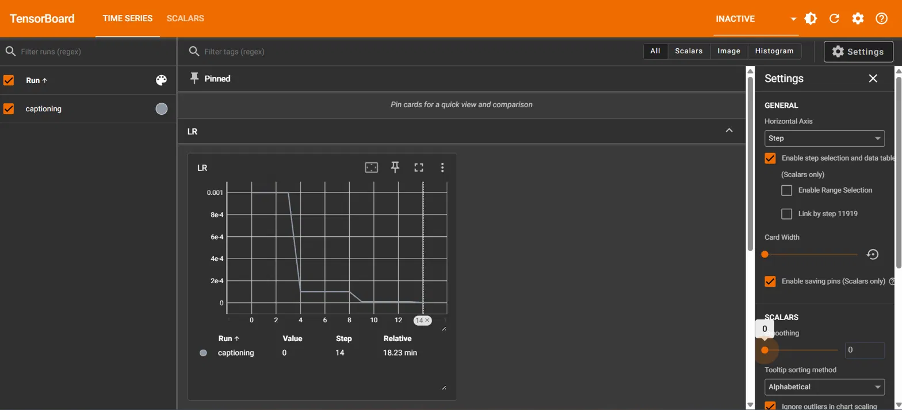
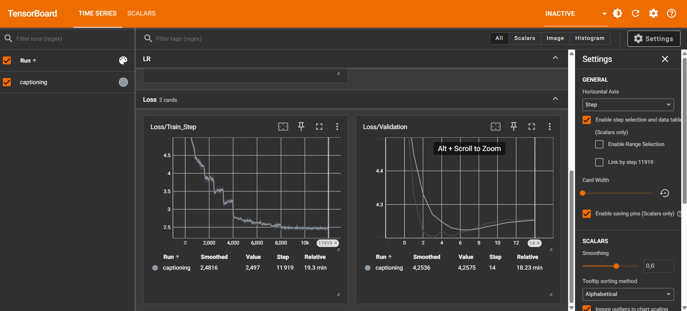

# TP5  Image Captioning avec RNN et attention sur ResNet

**Auteur :** Wassim Triki

**Identifiant TSP :** wtriki

Fichiers du dossier `TP5/` : `dataset.py`, `text_utils.py`, `model.py`, `train.py`, `run_captioning.sh`, `captures/`.

Entraînement : job Slurm n°54520, 15 époques, Adam (lr = 0.001), `StepLR(step_size=5, gamma=0.1)`, environ 18 minutes au total (~1 min 20 par époque).

---

## 1. Chargement des données et embeddings

Dataset : Flickr30k, séparé en 80 % train / 20 % test (`random_split` avec graine 42). Le vocabulaire du corpus compte 23 461 mots, dont 20 226 sont retrouvés dans Word2Vec (embeddings de dimension 300).

**Pourquoi redimensionner toutes les images en (224, 224) ?**

- **Contrainte technique du batch** : PyTorch empile les images d'un batch dans un seul tenseur `(32, 3, H, W)`. Cela exige que toutes les images aient la même taille. Avec des résolutions différentes, l'empilement échoue.
- **Contrainte du ResNet** : il a été pré-entraîné sur des images 224×224. Pour cette taille, la carte de sortie vaut 7×7 (224 / 32 = 7), ce qui donne les 49 régions utilisées par le module d'attention.
- **Coût prévisible** : une taille fixe rend la mémoire GPU et le temps de calcul constants d'un batch à l'autre.

---

## 2. Extraction de caractéristiques et transfer learning

On charge un ResNet50 pré-entraîné sur ImageNet et on retire ses deux dernières couches (`AdaptiveAvgPool2d` et `Linear`) pour conserver la grille spatiale.

**Pourquoi geler les poids du ResNet (`requires_grad = False`) ?**

- **Raison matérielle** : sans gel, la rétropropagation devrait calculer et stocker les gradients d'environ 23,5 millions de paramètres, ainsi que toutes les activations intermédiaires. Cela coûterait beaucoup de mémoire GPU et de temps. Avec le gel, seuls l'attention, le LSTM et la couche de sortie sont entraînés.
- **Raison algorithmique** : le ResNet a appris des caractéristiques visuelles générales sur 1,28 million d'images, alors que Flickr30k est bien plus petit. Au début de l'entraînement, le LSTM est aléatoire et ses gradients sont bruités. Les propager dans le ResNet avec lr = 0.001 risquerait de dégrader ses bonnes caractéristiques (oubli catastrophique) et de provoquer du sur-apprentissage.

**Forme de sortie pour une entrée `(32, 3, 224, 224)` :** `(32, 2048, 7, 7)`.

- 32 : la taille du batch ne change pas.
- 2048 : nombre de canaux en sortie de `layer4` du ResNet50.
- 7×7 : le ResNet réduit la taille spatiale d'un facteur 32 (224 / 32 = 7), soit 49 régions.

Vérification réalisée sur le cluster avec 2 images : `torch.Size([2, 2048, 7, 7])`.

---

## 3. Module d'attention et LSTM

Le LSTM est écrit à la main : à chaque pas de temps, on calcule le vecteur de contexte avec l'état caché courant, on le concatène au mot et à l'état caché précédent, puis on applique les quatre portes (entrée, oubli, candidat, sortie).

Vérification des dimensions avec des tenseurs aléatoires : sortie du LSTM `[2, 19, 512]`, état caché final `[2, 512]`.

**À quoi correspond `context_vector` ?**

C'est un résumé de l'image **propre au mot en cours d'écriture** : une somme des 49 régions pondérée par l'importance que le LSTM leur accorde à cet instant, en fonction de son état caché.

**Quel problème du Seq2Seq de base cela résout-il ?**

Dans un Seq2Seq de base, toute l'image est compressée dans un unique vecteur fixe, identique pour tous les mots de la phrase : c'est un goulot d'étranglement. Avec l'attention, le modèle consulte une zone différente de l'image à chaque pas de temps.

---

## 4. Modèle global et entraînement

Le modèle combine ResNet gelé, embeddings Word2Vec, LSTM avec attention (taille cachée 512) et une couche linéaire finale `nn.Linear(512, vocab_size)`. Le test avec un faux vocabulaire de 1000 mots donne bien `torch.Size([2, 19, 1000])`.

### 4.1 Évolution des phrases générées

La phrase affichée est calculée sur la dernière image du jeu de test (non mélangé), donc le même exemple est suivi à chaque époque.

Cible (identique à chaque époque) :
`four people are scuba diving in swimming pool two girls one bald man the third person you can only`

| Époque | Prédiction |
|---|---|
| 1 | man people are sitting in on the water with people are in man in other man in in be |
| 4 | two people in standing underwater or the pool with men wearing in one with other is wearing are be |
| 6 | two divers are standing underwater together scuba pool with others are wearing one in other is in are be |
| 10 | two men in standing underwater together scuba pool with men are wearing one in other is is can be |
| 15 | two men in standing underwater together scuba pool with others are wearing one in other is is can be |

**Observations :**

- **Le contenu visuel s'améliore nettement.** À l'époque 1, on trouve surtout des mots très fréquents (« man », « people », « in »), avec « water » comme seul indice de la scène. À partir des époques 4 à 6 apparaissent « underwater », « scuba », « pool », « divers », « wearing », qui correspondent à la scène réelle (scuba diving, swimming pool). L'attention et le ResNet extraient donc bien l'information visuelle.
- **La syntaxe reste faible.** Il y a des fragments cohérents (« two men in standing underwater », « others are wearing »), mais aussi des répétitions et des mots sans lien (« in other is is can be »). La grammaire ne s'est pas vraiment améliorée.
- **Entre les époques 7 et 15, la phrase est presque figée.** Les variations sont minimes (« men » / « others »).

**Limites du protocole à garder en tête :**

- **Teacher forcing** : la prédiction affichée n'est pas une légende générée librement. À chaque position, le modèle reçoit les vrais mots de la cible et prédit le mot suivant. C'est pourquoi la prédiction ressemble à la cible par morceaux.
- **Une seule légende par image** : le code utilise uniquement `captions[0]` parmi les 5 légendes disponibles, ce qui rend la cible plus bruitée.
- **Dégradation de la cible par `tokenize`** : les mots absents de Word2Vec sont supprimés (certains mots très fréquents comme « a » ou « and » n'y figurent généralement pas), d'où des cibles sans articles. De plus, la cible est tronquée à 20 mots.

L'amélioration est donc visible sur le vocabulaire, mais pas sur la grammaire. Pour une vraie évaluation, il faudrait générer les légendes mot par mot, sans teacher forcing.

### 4.2 Courbes TensorBoard

**Learning rate (smoothing à 0)**



**Loss d'entraînement (smoothing 0.6)**



**Loss de validation**


**Lecture des courbes :**

- **LR** : on observe l'escalier attendu, avec 0.001 pour les époques 1 à 5, 0.0001 pour 6 à 10, puis 0.00001 pour 11 à 15.
- **Loss d'entraînement** : elle descend d'environ 4,5 à environ 2,5. On voit une chute brutale vers le step 4 000, qui correspond à la première baisse du lr (fin de l'époque 5), puis un plateau lent.
- **Loss de validation** : elle atteint son minimum vers l'époque 6-7 (environ 4,25), puis remonte très légèrement jusqu'à environ 4,26 à l'époque 15. L'écart final avec la loss d'entraînement (environ 2,5 contre 4,26) indique un début de sur-apprentissage. Attention à l'échelle de l'axe : la remontée ne fait que quelques centièmes, il ne faut pas la surévaluer. Cela est cohérent avec le fait que les phrases ne progressent plus après l'époque 6.

### 4.3 Impact du StepLR

**Que se passerait-il en gardant lr = 0.001 jusqu'au bout ?**

- Avec un pas trop grand, le modèle oscillerait autour du minimum au lieu de s'y stabiliser : la loss d'entraînement descendrait plus lentement et resterait plus bruitée.
- Les derniers ajustements, qui demandent des mises à jour fines, seraient impossibles. Les phrases générées resteraient instables d'une époque à l'autre.
- Le gain observé lors de la première baisse du lr (chute brutale de la loss d'entraînement vers le step 4 000) montre que le lr initial est trop grand pour la fin de l'entraînement.
- Avec un lr élevé, le risque de sur-apprentissage sur les gradients bruités des derniers batchs serait plus marqué.

**Pourquoi la décroissance du lr est-elle particulièrement pertinente avec Adam ?**

- Adam normalise chaque mise à jour par la racine de la moyenne des gradients au carré (comme RMSprop). Quand les gradients deviennent petits près du minimum, le pas effectif reste donc de l'ordre de `lr`, et ne diminue pas de lui-même.
- Adam lisse aussi la direction avec un momentum (moyenne des gradients passés). Cette inertie peut faire dépasser ou osciller autour du minimum.
- Réduire explicitement le lr diminue directement la taille des pas, ce qui permet à l'optimiseur de se stabiliser en fin d'entraînement.

---

## 5. Reproduction

```bash
sbatch run_captioning.sh
tail -f logs/captioning-<JOBID>.out
tensorboard --logdir runs --port 6006 --host localhost
```
