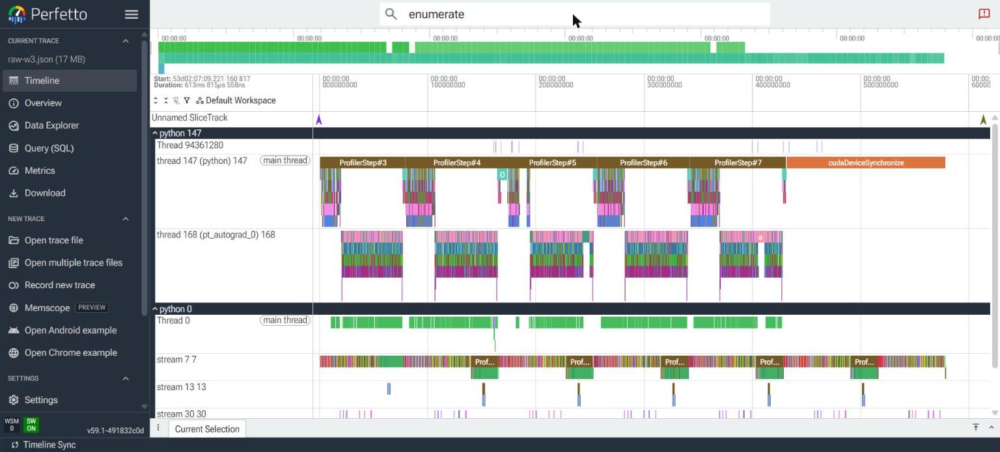
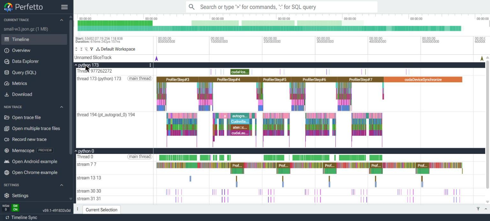

# TP6 — Accélérer un ResNet

**Auteur :** Wassim Triki — **Identifiant TSP :** wtriki

Dossier `TP6/` : scripts Python (`common.py`, `bench.py`, `profile_run.py`, `train.py`, `check_env.py`, `check_dist.py`, `ddp_bench.py`, `quantize.py`, `summarize.py`), scripts sbatch (`ex0.sh`, `ex1.sh`, `ex2.sh`, `ex3.sh`, `train.sh`, `ddp_l4.sh`, `ex5.sh`), fichiers `results_*.csv`, dossier `captures/`.

**Jobs Slurm :** ex0 = 56697, ex1 = 56698, ex2 = 56699, ex3 = 56700, train = 56701, ddp = 56702, ex5 = 56703.

**Remarques sur le protocole :**

- Le cluster impose `--account=csc_8607` : cette ligne a été ajoutée à tous les scripts sbatch.
- L'environnement conda `deeplearning` contenait torch 2.5.1, trop ancien pour torchao 0.18 et pour `fp32_precision`. Un environnement `tp6` (Python 3.11, torch 2.14.1, torchvision 0.29.2, torchao 0.18.0) a été créé, et `tp6_env.sh` l'active.
- Les jobs H100 ont reçu **un H100 NVL entier** (95 321 Mio de mémoire visibles), et non une tranche MIG 1g.12gb comme le suppose le sujet. Cela change le batch maximal (exercice 1) et se retrouve dans les commentaires.

---

## Exercice 0 : mise en place

Sortie de `check_env.py` (job 56697) :

```
Machine        : arcadia-slurm-node-3
Python         : 3.11.18
torch          : 2.14.1+cu130 (CUDA 13.0)
torchvision    : 0.29.2+cu132
torchao        : 0.18.0
CPU alloués    : 4  (x86_64)
Drapeaux CPU   : avx512f, avx512_vnni, avx512_bf16
gcc            : /usr/bin/gcc
GPU            : NVIDIA H100 NVL
Mémoire GPU    : 95321 Mio au total, 94795 Mio libres
bf16 supporté  : True
Données raw    : /mnt/ssd/imagenet/2012 -> (12894, 500) images (train, val)
Données small  : /tmp/wtriki/tp6/imagenet10_256 -> (12894, 500) images (train, val)
Poids ResNet-50 pré-entraînés : OK
```

**Conséquence de 4 CPU pour un septième de H100 :** le chargement des images sera très probablement le goulot. Décoder un JPEG et appliquer `RandomResizedCrop` coûte plusieurs millisecondes de CPU par image. Le processus principal occupe un cœur (lancement des noyaux CUDA, assemblage des batchs, thread de `pin_memory`), il reste donc environ 3 workers utiles. Dès que le GPU devient rapide (bf16, `channels_last`), il attend les données. Les exercices 1 à 3 le confirment.

---

## Exercice 1 : mesure de référence

| Mesure | Débit (img/s) | Pic mémoire | Temps d'une époque |
|---|---|---|---|
| ref-synth (fp32, batch 64) | 729,3 (min 727,4 / max 731,0) | 5,95 Go | — |
| ref-raw (3 workers) | 714,3 (min 712,1 / max 714,6) | 5,95 Go | 19,7 s |

**Estimation du pic mémoire de ref-synth (méthode du cours) :**

| Terme | Valeur |
|---|---|
| Poids (23,5 M × 4 o) | 94 Mo |
| Gradients | 94 Mo |
| États d'AdamW (2 × 94 Mo) | 188 Mo |
| Activations (64 × 84 Mo) | 5,38 Go |
| **Total estimé** | **≈ 5,75 Go** |

Mesure : **5,95 Go**, soit un écart d'environ 0,2 Go (3,5 %). L'estimation ignore le batch d'entrée lui-même (≈ 38 Mo), les espaces de travail temporaires de cuDNN et les tampons de l'allocateur CUDA. L'estimation du cours est donc bonne.

**ref-async :** l'appel de `step()` retourne en **11,6 ms**, alors que le pas réel dure **86,7 ms**. Le CPU ne fait que *lancer* les noyaux CUDA et rend la main pendant que le GPU travaille encore. Sans `torch.cuda.synchronize()`, on mesurerait 11,6 ms, soit environ 5 500 img/s : un débit **7,5 fois trop optimiste**. Le chronométrage serait faux.

**Batch maximal en fp32 : 1128** (`results_maxbatch.csv`). Le cours annonçait « de l'ordre de 120 », ce qui suppose une tranche MIG d'environ 12 Go. Ici le GPU est un H100 NVL entier de 94 Go. Vérification : 1128 × 84 Mo ≈ 94,8 Go, soit presque toute la mémoire. Avec 12 Go, on retrouve environ 130-140 images, l'ordre de grandeur du cours. L'écart vient donc de la mémoire disponible, pas d'une erreur du cours.

**ref-raw contre ref-synth :** ref-raw atteint 714,3 / 729,3 ≈ **98 %** du débit synthétique. En fp32, le GPU est le facteur limitant : 3 workers suffisent à le nourrir. Cette conclusion ne tiendra plus quand le GPU accélère (exercice 3). L'époque mesurée (19,7 s) est un peu plus longue que 201 pas × 87,8 ms ≈ 17,6 s à cause du démarrage des workers et du remplissage du premier lot.

---

## Exercice 2 : chargement des données et profilage

| Config | Débit (img/s) | min – max |
|---|---|---|
| raw-w0 | 233,9 | 231,9 – 235,8 |
| raw-w1 | 348,4 | 347,2 – 349,7 |
| raw-w2 | 690,8 | 668,5 – 713,1 |
| raw-w3 | 720,6 | 718,9 – 722,4 |
| raw-w3-nopin | 652,6 | 652,5 – 652,7 |
| small-w0 | 273,1 | 272,2 – 274,0 |
| small-w3 | 713,6 | 713,2 – 713,9 |

**Évolution avec le nombre de workers.** Le débit monte presque linéairement : 233,9 → 348,4 (×1,5) → 690,8 (×3 par rapport à 0 worker) → 720,6. Il plafonne vers 729 img/s, le débit du GPU seul. À 3 workers, on est à 98,8 % de ce plafond : le GPU est saturé.

**Pourquoi pas plus de 3 workers utiles avec 4 CPU.** Le processus principal occupe un cœur. Un 4ᵉ worker se disputerait les cœurs sans gain. Et le GPU est déjà saturé à 3 workers.

**Effet de `pin_memory` : 720,6 → 652,6 img/s, soit −9,4 %.** La mémoire « épinglée » (page-locked) est une zone de RAM que le GPU peut lire directement par DMA. Avec `non_blocking=True`, la copie CPU → GPU se fait alors en parallèle du calcul. Sans épinglage, la copie passe par un tampon temporaire et bloque le pas : environ 9 ms de plus par batch (98,1 ms contre 88,8 ms).

**Pourquoi `small` se charge plus vite.** Les images sont déjà réduites (côté court 256 px) : moins de pixels à décoder, moins d'octets à lire. Le modèle voit les mêmes photos et les mêmes étiquettes, mais à résolution réduite. Le `RandomResizedCrop` découpe une zone d'une image plus petite puis la redimensionne à 224 : les petits recadrages sont un peu plus flous. Pour la validation, le résultat est quasi identique, puisque `Resize(256)` fait déjà cette réduction.

**Temps de décodage `t_d`** avec 1/D_w0 ≈ t_d + 1/D_synth (1/D_synth = 1,37 ms) :

| Source | 1/D_w0 | t_d | Débit d'un worker (1/t_d) | Débit max de 3 workers |
|---|---|---|---|---|
| raw | 4,28 ms | **≈ 2,90 ms** | ≈ 345 img/s | ≈ 1 035 img/s |
| small | 3,66 ms | **≈ 2,29 ms** | ≈ 437 img/s | ≈ 1 310 img/s |

La valeur raw est confirmée par raw-w1 (348,4 img/s mesurés). Au-delà de ces débits de GPU, 3 workers ne suffiront plus.

**Traces Perfetto.**

Capture raw-w3 :



Capture small-w3 :



**Lecture de la trace raw-w3 :**

- Le flux CUDA (`stream 7`, sous `python 0`) est **rempli en continu** pendant toute la trace : les noyaux de convolution et les autres noyaux s'enchaînent sans trou visible. Le GPU ne manque pas de travail.
- Côté CPU, le thread principal et le thread `pt_autograd_0` ne servent qu'à **lancer** les noyaux. Les 5 pas profilés (`ProfilerStep#3` à `#7`) durent environ 120 ms chacun, et les lancements du dernier pas se terminent vers 430 ms, alors que le GPU travaille encore jusqu'à environ 580 ms. Le thread principal attend cet écart (environ 150 ms) dans `cudaDeviceSynchronize`, le grand bloc orange à droite. Le CPU a donc de l'avance sur le GPU : la file de noyaux ne se vide jamais.
- Je n'ai pas isolé d'attente notable sur `enumerate(DataLoader)...__next__` : les batchs sont prêts quand le GPU en a besoin.

Le profil type est donc **limité par le calcul** (le GPU est le facteur limitant), et non par les données ni par le lancement. C'est cohérent avec le débit : raw-w3 atteint plus de 98 % du débit synthétique fp32.

**Lecture de la trace small-w3 :** même profil que raw-w3. Le flux CUDA (`stream 7`) est rempli en continu sans trou visible, les 5 pas (`ProfilerStep#3` à `#7`) ne servent qu'à lancer les noyaux côté CPU, et le thread principal termine par un long `cudaDeviceSynchronize` (le GPU finit après le CPU). Le profil est **limité par le calcul**, ce qui correspond au débit (713,6 img/s, soit 97,8 % du débit synthétique). La copie redimensionnée accélère le décodage (t_d ≈ 2,29 ms contre 2,90 ms), mais en fp32 cet avantage ne se voit pas sur le débit : le GPU est déjà le facteur limitant. Il apparaîtrait avec un GPU plus rapide (bf16, `compile`), comme on l'a vu à l'exercice 3.

**Fraction du débit synthétique avec la meilleure configuration de chargement :** raw-w3 donne 720,6 / 729,3 ≈ **98,8 %** (small-w3 : 97,8 %). L'écart entre raw et small est dans le bruit de mesure, car le GPU limite en fp32.

---

## Exercice 3 : précision mixte, `channels_last`, `torch.compile`

### Tableau des mesures (ex3.sh, job 56700)

| Config | Données | Débit (img/s), min – max | Pic mémoire | Compilation |
|---|---|---|---|---|
| fp32 | synthétique | 724,6 (723,1 – 727,5) | 5,95 Go | — |
| tf32 | synthétique | 1 646,4 (1 623 – 1 664) | 5,93 Go | — |
| bf16 | synthétique | 1 992,3 (1 990 – 1 993) | 3,29 Go | — |
| bf16 + channels_last | synthétique | 3 428,6 (3 306 – 3 437) | 3,29 Go | — |
| bf16 + cl + compile | synthétique | 4 229,5 (4 025 – 4 318) | 3,07 Go | 37,1 s |
| bf16-cl | raw, 1 worker | 320,0 (260 – 336) | 3,29 Go | — |
| bf16-cl + compile | raw, 1 worker | 303,3 (276 – 327) | 3,07 Go | 3,6 s |
| bf16-cl | raw, 3 workers | 2 361 (2 306 – 3 291) | 3,29 Go | — |
| bf16-cl + compile | raw, 3 workers | 3 781 (3 383 – 4 095) | 3,07 Go | 3,9 s |
| bf16-cl | small, 1 worker | 491,1 (374 – 504) | 3,29 Go | — |
| bf16-cl + compile | small, 1 worker | 497,7 (330 – 517) | 3,07 Go | 3,9 s |
| bf16-cl | small, 3 workers | 3 224 (2 567 – 3 309) | 3,29 Go | — |
| bf16-cl + compile | small, 3 workers | 2 288 (1 761 – 4 214) | 3,07 Go | 3,7 s |

### Reproductibilité

fp32-synthetic donne 724,6 img/s contre 729,3 pour ref-synth : même configuration, deux mesures. L'écart relatif est de **0,64 %**. La mesure est donc reproductible à moins de 1 % : un gain plus petit serait indiscernable du bruit, mais tous les gains observés ensuite sont de plusieurs dizaines de pourcents.

### Gain de chaque étape (synthétique)

| Étape | Débit | Gain sur l'étape précédente |
|---|---|---|
| fp32 → TF32 | 724,6 → 1 646,4 | ×2,27 |
| TF32 → bf16 | 1 646,4 → 1 992,3 | ×1,21 |
| bf16 → + channels_last | 1 992,3 → 3 428,6 | ×1,72 |
| + channels_last → + compile | 3 428,6 → 4 229,5 | ×1,23 |
| **Total fp32 → meilleure config** | | **×5,84** |

- **TF32 (×2,27).** Les convolutions et les produits matriciels passent des unités fp32 classiques aux **Tensor Cores**. TF32 garde la plage de valeurs du fp32 mais réduit la mantisse à 10 bits. Les tenseurs restent en 32 bits en mémoire : le pic mémoire ne change pas.
- **bf16 (×1,21).** Les données font 2 octets au lieu de 4 : le **trafic mémoire est divisé par 2** pour les opérations limitées par la mémoire (BatchNorm, ReLU, additions résiduelles). Les Tensor Cores sont aussi plus rapides en bf16. La mémoire baisse de 5,95 à 3,29 Go, car les activations sont stockées en 16 bits (poids et états de l'optimiseur restent en fp32).
- **channels_last (×1,72).** Les Tensor Cores travaillent nativement sur la disposition **NHWC**. En NCHW, PyTorch insère des noyaux de transposition avant et après chaque convolution. Le format `channels_last` les supprime.
- **torch.compile (×1,23).** Le compilateur **fusionne** des opérations successives (BatchNorm + ReLU + addition) en un seul noyau, ce qui évite des allers-retours en mémoire et réduit le nombre de lancements de noyaux. La mémoire baisse un peu (3,07 Go), car moins de tenseurs intermédiaires sont conservés.

### Synthétique contre vraies images

- **À 1 worker, le goulot est le chargement.** L'estimation de l'exercice 2 le prévoyait : un worker fournit environ 345 img/s en raw et 437 img/s en small, et on mesure 320 et 491.
- **`compile` ne rapporte rien quand le chargement limite** : 320 → 303 en raw et 491 → 498 en small sont des écarts dans le bruit. Accélérer le GPU n'aide pas s'il attend déjà les données.
- **Dispersion à 1 worker :** 260 à 336 img/s (environ ±13 %), contre moins de 4 % en synthétique. Quand le chargement limite, la mesure dépend du CPU partagé avec les voisins du nœud.
- **Loi d'Amdahl.** Le décodage représente environ 68 % du temps à 0 worker (2,9 ms sur 4,28 ms). Accélérer le reste d'un facteur 4,7 donne au mieux 1 / (0,68 + 0,32 / 4,7) ≈ ×1,33, et on mesure ≈ ×1,37 (320 contre 233,9). La partie non accélérée plafonne le gain.
- **À 3 workers**, les débits du benchmark court (2 361 en raw, 3 224 en small) dépassent l'estimation de l'exercice 2 (≈ 1 035 et ≈ 1 310 img/s), et la dispersion est grande. Le benchmark ne mesure que 30 pas : il bénéficie probablement des batchs préchargés (3 workers × `prefetch_factor` 4). La mesure sur une époque entière (voir `train.py` plus bas, 1 090 à 1 200 img/s en small) est cohérente avec l'estimation de l'exercice 2. C'est elle qu'il faut retenir pour conclure : **à 3 workers, le chargement reste le facteur limitant**. La ligne `compile + small-w3` (2 288 img/s, min 1 761) est inférieure à la version sans compile (3 224) : c'est du bruit de mesure, pas un effet réel.

### Combien de workers pour un H100 entier ?

Le nombre de workers nécessaires est le débit visé multiplié par le temps de décodage par image. Pour 4 229 img/s : environ 4 229 × 2,29 ms ≈ **10 workers en small** et 4 229 × 2,90 ms ≈ **12 workers en raw**. Les 30 cœurs d'un nœud suffisent pour un GPU, mais pas pour plusieurs GPU alimentés en même temps.

### Compilation

La compilation a lieu cinq fois dans ex3.sh. La première prend **37,1 s**, les suivantes seulement **3,6 à 3,9 s** : Inductor garde sur disque les noyaux déjà compilés (le graphe est le même), donc les recompilations sont presque gratuites.

- Gain par pas : 64 / 3 428,6 − 64 / 4 229,5 ≈ 18,67 − 15,13 = **3,54 ms**.
- Itérations pour amortir : 37,1 s / 3,54 ms ≈ **10 500** sans cache, 3,7 s / 3,54 ms ≈ **1 050** avec cache.
- Deux époques représentent 2 × 201 = 402 pas : gain total d'environ 402 × 3,54 ms ≈ 1,4 s. **Ce n'est pas rentable**, ni avec ni sans cache. Et comme le chargement limite, `compile` ne changerait rien.

### Batch maximal en bf16

**2200**, contre **1128** en fp32 : un rapport de **1,95**. Le cours prédit environ 2, parce que bf16 divise par deux la taille des activations, qui dominent la mémoire. Le rapport n'est pas exactement 2 parce que les poids, gradients et états d'AdamW (≈ 0,4 Go) restent en fp32.

### Entraînement court (`train.py`, job 56701)

Configuration : bf16, `channels_last`, **sans** `--compile` (non rentable sur 2 époques, voir ci-dessus), données small, 3 workers.

| Époque | Durée | Débit | Top-1 validation |
|---|---|---|---|
| 0 | 10,7 s | 1 199 img/s | 0,990 |
| 1 | 11,8 s | 1 089 img/s | 0,998 |

- Meilleur top-1 : **0,998** (499 images sur 500). Les 10 classes d'Imagenette viennent d'ImageNet, que le ResNet-50 pré-entraîné connaît déjà.
- **La première époque n'est pas plus lente** ici (10,7 s contre 11,8 s). Les effets attendus (démarrage des workers, recherche d'algorithmes cuDNN, remplissage du cache disque, et compilation si on l'active) sont trop petits pour émerger : on a retiré `--compile` et les images sont en cache. L'écart de 10 % en sens inverse est de l'ordre du bruit dû au CPU partagé.
- **Facteur d'accélération par rapport à ref-raw** (19,7 s par époque) : 19,7 / 11,25 (moyenne des deux époques) ≈ **×1,75**. Le GPU a accéléré de ×5,8 en synthétique, mais le gain total est limité par le chargement des données (loi d'Amdahl).

---

## Exercice 4 : DDP sur deux nœuds L4 (job 56702)

### Communication (`logs/nccl-56702.log`)

- Transport NCCL : **`NET/Socket`** (sockets TCP/IP sur l'interface `ens18`). `NET/IB : No device found` : pas d'InfiniBand.
- All-reduce de 102 Mo : **877,0 ms** ; débit algorithmique **0,12 Go/s**, débit par lien **0,12 Go/s** (identiques : avec 2 processus, le facteur 2(N−1)/N vaut 1).
- Conversion : 102,2 Mo / 0,877 s ≈ 116,5 Mo/s ≈ **0,93 Gbit/s**. C'est un lien **Ethernet 1 Gbit/s** saturé.

### Mesures

| Tag | Processus | Temps/pas | Débit (img/s) | S = D₂/D₁ | E = S/2 |
|---|---|---|---|---|---|
| l4-x1 (référence) | 1 | 136,5 ms | 468,7 | — | — |
| l4-x2 | 2 | 867,6 ms | 147,5 | 0,315 | 0,16 |
| l4-x2-bf16hook | 2 | 463,2 ms | 276,4 | 0,590 | 0,29 |
| l4-x1-accum8 (référence accumulation) | 1 | 1 036,8 ms | 493,8 | — | — |
| l4-x2-accum8-bf16hook | 2 | 1 359,1 ms | 753,4 | 1,526 | 0,76 |

Le test de communication (A) n'a pas de ligne dans `results_ddp.csv`. Sans accumulation, le DDP sur deux nœuds est **plus lent** qu'un seul GPU (S < 1).

### Estimation de la communication

- Gradients fp32 : 23,5 M × 4 o ≈ 94 Mo, donc **t_c ≈ 94 / 102 × 877 ≈ 807 ms**.
- Sans recouvrement : t₁ + t_c = 136,5 + 807 ≈ **944 ms**. Recouvrement parfait : max(t₁, t_c) ≈ **807 ms**.
- **Mesuré : 867,6 ms**, entre les deux cas, plus proche du cas parfait.
- **Durée de calcul cachée par le recouvrement** : t_rec = t₁ + t_c − T₂ = 136,5 + 807 − 867,6 ≈ **76 ms**. Pendant le backward, les gradients des dernières couches partent sur le réseau pendant que les premières sont encore en calcul.

### Effet de `--bf16-hook`

Le temps par pas passe de 867,6 à **463,2 ms (÷ 1,87)**. Le réseau est le goulot, donc le temps de communication est proportionnel aux octets envoyés, et bf16 les divise par 2 (t_c ≈ 404 ms). Vérification : 136,5 + 404 − 76 ≈ 464 ms, ce qui correspond à la mesure. **Risque :** bf16 n'a que 7 bits de mantisse, donc les sommes de gradients perdent en précision, avec un possible effet sur la convergence.

### Pourquoi pas Amdahl, et prédiction

Amdahl suppose une fraction série fixe et des accélérations toujours supérieures ou égales à 1. Ici la communication est un **coût fixe par pas** (il dépend de la taille du modèle et du réseau, pas du batch), et on observe un **ralentissement** (S < 1), ce que la loi ne peut pas décrire.

Modèle : T₂ ≈ k·t₁ + t_c − t_rec. **Prédiction** pour `l4-x2-accum8-bf16hook` (k = 8, t_c ≈ 404 ms avec bf16, t_rec ≈ 76 ms) : 8 × 136,5 + 404 − 76 ≈ **1 420 ms**. **Mesure : 1 359 ms**, soit 4 % d'écart. Avec la référence accumulation (1 036,8 ms pour 8 micro-batchs) à la place de 8 × t₁, la prédiction devient 1 365 ms, soit 0,4 % d'écart.

### Quand le DDP multi-nœuds est-il rentable ?

Quand le calcul par pas est grand devant la communication (k·t₁ ≫ t_c). Deux leviers :

- **Accumulation de gradients** : une seule communication tous les 8 micro-batchs. *Prix :* un très gros batch effectif (1 024), donc moins de mises à jour par époque et un learning rate à réajuster.
- **Compression bf16 des gradients** : les octets sont divisés par 2. *Prix :* une perte de précision sur les gradients.

Un réseau plus rapide (InfiniBand) serait un troisième levier, au prix du matériel.

### Learning rate avec un gros batch

Le batch effectif passe de 128 à 1 024 (×8).

- **SGD** : règle linéaire, lr × 8, avec une phase de chauffe (warm-up).
- **AdamW** : Adam normalise déjà les gradients, on utilise plutôt la règle de la racine carrée, lr × √8 ≈ × 2,8, avec warm-up.

### Graine, sampler, `no_sync`

- **Même graine pour l'initialisation** : tous les processus doivent partir des mêmes poids, car chacun applique la même mise à jour (gradient moyenné) et les copies doivent rester identiques.
- **Données différentes par processus** : sinon tous calculent le même gradient, et le moyenner n'apporte rien (le batch effectif ne grandit pas).
- **Sans `sampler.set_epoch(epoch)`** : le mélange est identique à chaque époque, donc les mêmes batchs dans le même ordre, ce qui réduit l'aléa de l'apprentissage et peut gêner la généralisation.
- **Sans `model.no_sync()`** : DDP ferait un all-reduce à chaque micro-batch, soit 8 communications par pas au lieu d'une. Le résultat serait mathématiquement le même, mais avec environ 8 fois plus de communication : tout le gain de l'accumulation disparaîtrait.

---

## Exercice 5 : quantification int8 sur CPU (job 56703)

### Résultats de `calib200` (4 threads, batch 1, 500 images de validation)

| Variante | Taille (Mo) | Latence (ms) | Premier appel (s) | Top-1 | Accord fp32 | Écart logits |
|---|---|---|---|---|---|---|
| fp32 sans compilation | 94,3 | 40,64 | 0,0 | 0,998 | 1,000 | 0 |
| fp32 compilé | 94,3 | 21,01 | 15,9 | 0,998 | 1,000 | 0 |
| bf16 compilé | 47,2 | 12,10 | 5,1 | 0,998 | 1,000 | 0,0229 |
| int8 compilé | 23,9 | 7,65 | 2,9 | 0,996 | 0,996 | 0,0860 |

**Rapport de taille.** 94,3 / 23,9 ≈ **3,95**, pas exactement 4. Les poids sont bien 4 fois plus petits, mais le modèle quantifié conserve des tenseurs en précision supérieure : les échelles et points zéro de quantification, et les biais (notamment ceux issus du repliement des BatchNorm). `weights_mb` ne compte que les tenseurs réellement lus par le graphe (nœuds `get_attr`). Le modèle converti par `convert_pt2e` garde aussi, inutilisés, les poids fp32 d'origine : son `state_dict` inclurait donc ces poids en plus des poids int8 et surestimerait la taille.

**Latences.** Il faut comparer l'int8 au **fp32 compilé** (21,01 ms) et non au fp32 sans compilation (40,64 ms). La compilation seule apporte déjà ×1,93 (fusion d'opérations, noyaux mkldnn). Comparer à la version non compilée attribuerait à l'int8 un gain (×5,3) qui vient en grande partie du compilateur. Le vrai gain de l'int8 est **×2,75** (21,01 / 7,65). Il est cohérent avec les drapeaux CPU de l'exercice 0 : `avx512_vnni` fournit une instruction qui calcule des produits scalaires int8 par groupes de 4 et les accumule en int32, soit jusqu'à 4 fois plus d'opérations par instruction qu'en fp32. On n'atteint pas ×4 parce que les opérations autres que les convolutions (quantification et déquantification, pooling, additions résiduelles) ne bénéficient pas du même gain. Le bf16 (×1,74 par rapport au fp32 compilé) s'appuie sur `avx512_bf16`. Il n'y a pas de drapeau `amx` sur ces CPU : les unités AMX, qui accélèrent encore plus bf16 et int8, ne sont pas disponibles.

**Perte de précision.** Le top-1 passe de 0,998 à 0,996, soit −0,2 point, c'est-à-dire **une seule image sur 500**. Le top-1 ne suffit pas à juger la quantification ici : la tâche est facile (modèle pré-entraîné, 10 classes, top-1 proche de 1), donc il est saturé, et 500 images donnent une résolution de 0,2 point. L'accord avec le fp32 non compilé (0,996) et surtout l'**écart moyen des logits** (0,086 pour l'int8, contre 0,023 pour le bf16) mesurent plus finement la déformation du modèle. Le bf16 est nettement plus proche du fp32.

**Calibration (calib200 contre calib10).**

| Calibration | Top-1 | Accord fp32 | Écart logits |
|---|---|---|---|
| 200 images | 0,996 | 0,996 | 0,0860 |
| 10 images | 0,996 | 0,996 | 0,0819 |

Les deux sont équivalents : l'écart de logits de calib10 est même légèrement meilleur (0,0819), ce qui est dans le bruit. Le rôle de la calibration est de faire noter aux observateurs les valeurs min et max des activations sur des images représentatives, pour fixer les échelles de quantification. Une calibration trop pauvre ou non représentative donnerait de mauvaises plages (écrêtage ou perte de résolution). Ici, 10 images régulièrement espacées (`spread`, donc une par classe) suffisent, car la tâche est simple.

**1 thread contre 4 threads (`threads1`, 100 images).**

| Variante | 1 thread | 4 threads | Accélération |
|---|---|---|---|
| fp32 compilé | 97,19 ms | 21,01 ms | ×4,6 |
| int8 compilé | 23,31 ms | 7,65 ms | ×3,05 |

L'accélération n'est pas strictement proportionnelle au nombre de threads : ×4,6 en fp32 (légèrement supérieure à 4, effet probable des caches et du bruit du nœud partagé), seulement ×3,05 en int8, car les noyaux int8 sont plus courts et la part non parallélisable (surcoût du framework, quantification/déquantification) pèse davantage (loi d'Amdahl). L'avantage de l'int8 est plus grand à 1 thread (×4,17) qu'à 4 (×2,75). **Pour le déploiement :** un seul thread int8 (23,3 ms) est presque aussi rapide que 4 threads fp32 (21,0 ms). Pour maximiser le débit, mieux vaut lancer plusieurs instances à 1 thread (4 × 1/23,3 ms ≈ 172 img/s sur 4 cœurs) qu'une seule instance à 4 threads (1/7,65 ms ≈ 131 img/s). Les threads supplémentaires ne valent la peine que si on vise la latence minimale d'une requête isolée.

**Pourquoi une quantification dynamique serait presque sans effet sur un ResNet.** En PyTorch, la quantification dynamique ne s'applique qu'aux couches `Linear` (et récurrentes) : les poids sont en int8 et les activations sont quantifiées à la volée. Un ResNet-50 est composé à plus de 99 % de convolutions, la seule couche `Linear` étant la dernière (2048 × 10). Presque rien ne serait donc quantifié, avec très peu de gain en taille et en vitesse. La quantification statique, elle, quantifie les convolutions grâce à des échelles calibrées à l'avance.

---

## Rapport final

### Tableau comparatif

| Configuration | Matériel | Données | Débit (img/s) | Pic mémoire | Temps par époque |
|---|---|---|---|---|---|
| ref-synth (fp32) | H100 NVL | synthétique | 729,3 | 5,95 Go | — |
| ref-raw (fp32, 3 workers) | H100 NVL | raw | 714,3 | 5,95 Go | 19,7 s |
| TF32 | H100 NVL | synthétique | 1 646,4 | 5,93 Go | — |
| bf16 | H100 NVL | synthétique | 1 992,3 | 3,29 Go | — |
| bf16 + channels_last | H100 NVL | synthétique | 3 428,6 | 3,29 Go | — |
| bf16 + cl + compile (meilleur GPU seul) | H100 NVL | synthétique | 4 229,5 | 3,07 Go | — |
| `train.py` bf16 + cl, 3 workers | H100 NVL | small | 1 089 – 1 199 | — | 10,7 – 11,8 s |
| DDP 1 L4 | L4 | synthétique | 468,7 | — | — |
| DDP 2 L4, sans compression | 2 × L4 | synthétique | 147,5 | — | — |
| DDP 2 L4, bf16-hook | 2 × L4 | synthétique | 276,4 | — | — |
| DDP 2 L4, accum 8 + bf16-hook | 2 × L4 | synthétique | 753,4 | — | — |
| Inférence fp32 compilé (4 threads) | CPU | val (batch 1) | 47,6 (21,01 ms) | 94,3 Mo | — |
| Inférence bf16 compilé | CPU | val (batch 1) | 82,6 (12,10 ms) | 47,2 Mo | — |
| Inférence int8 compilé | CPU | val (batch 1) | 130,7 (7,65 ms) | 23,9 Mo | — |

Les valeurs de débit en inférence sont calculées comme 1 / latence.

### Analyse des écarts à l'accélération idéale en DDP

L'accélération idéale avec 2 GPU serait ×2, soit un temps par pas égal à t₁ = 136,5 ms et un débit d'environ 937 img/s. Les mesures donnent S = 0,315 sans compression, 0,590 avec compression bf16, et 1,526 avec accumulation en plus.

- **Communication :** c'est la quasi-totalité de l'écart. Sans compression, t_c ≈ 807 ms représente environ **93 % du temps d'un pas de 867,6 ms**. Le lien Ethernet 1 Gbit/s ne laisse passer que 116 Mo/s, soit environ 0,9 s pour 94 Mo de gradients, contre 137 ms de calcul. La compression bf16 la divise par 2 (t_c ≈ 404 ms). L'accumulation de 8 micro-batchs l'amortit (une communication pour 8 calculs de 136 ms).
- **Chargement des données :** nul dans ces mesures (données synthétiques déjà sur le GPU). En entraînement réel, un nœud L4 dispose de 8 CPU, ce qui suffit pour environ 470 img/s (≈ 1,1 worker à 437 img/s par worker en small).
- **Synchronisation entre processus :** le pas est imposé par le plus lent des deux (réduction par MAX). Les deux GPU sont identiques et les données synthétiques, donc le déséquilibre est faible. Il n'est pas mesurable séparément : il est inclus dans le terme de recouvrement t_rec ≈ 76 ms, qui est déduit de la mesure.
- **Recouvrement :** il cache environ 76 ms de communication derrière le backward, ce qui est peu devant les 807 ms à transférer.

### Recommandation

**Pour entraîner ce modèle sur ce cluster :**

- **Précision : bf16** (autocast), ×2,75 par rapport à fp32 en synthétique avec un pic mémoire presque divisé par 2 (3,29 Go contre 5,95 Go).
- **Format mémoire : `channels_last`**, le plus gros gain après le passage aux Tensor Cores (×1,72).
- **Compilation :** `torch.compile` seulement pour un entraînement long. Il faut environ 1 050 pas (avec cache d'Inductor) à 10 500 pas (sans) pour amortir la compilation. Pour 2 époques (402 pas), ce n'est pas rentable, et le chargement limite de toute façon.
- **Chargement :** copie redimensionnée (`small`) sur le disque local du nœud, **3 workers**, `pin_memory=True` et `non_blocking=True`. Le goulot de l'entraînement réel est le chargement (≈ 1 100 – 1 200 img/s mesurés contre 3 428 en synthétique) : avec 4 CPU, c'est la vraie limite, plus que le GPU.
- **Nombre de GPU : un seul H100.** Deux L4 reliées par du 1 Gbit/s, même avec accumulation et compression bf16, n'atteignent que 753 img/s synthétiques (efficacité 76 %), moins qu'un seul H100 en données réelles (≈ 1 100 – 1 200 img/s). Le DDP multi-nœuds ne devient intéressant que sur un réseau bien plus rapide.

**Pour le déploiement sur CPU :** la variante **int8 (quantification statique PTQ avec torchao)** : modèle 3,95 fois plus petit (23,9 Mo), 2,75 fois plus rapide que le fp32 compilé (7,65 ms contre 21,01 ms) pour une perte de 0,2 point de top-1 sur 500 images, avec une calibration de 10 à 200 images représentatives. Si la précision est critique, le **bf16** est un bon compromis : modèle 2 fois plus petit, ×1,74 plus rapide, écart de logits 4 fois plus faible (0,023 contre 0,086). Pour maximiser le débit sur un nœud CPU, il vaut mieux lancer plusieurs instances à 1 thread qu'une seule instance multi-threads.

---

## Reproduction

```bash
mkdir -p TP6/logs && cd TP6
source ~/miniforge3/etc/profile.d/conda.sh && conda activate tp6
sbatch ex0.sh; sbatch ex1.sh; sbatch ex2.sh; sbatch ex3.sh   # un à la fois sur les H100
sbatch train.sh; sbatch ddp_l4.sh; sbatch ex5.sh
python summarize.py      # tableaux Markdown à partir des results_*.csv
```
